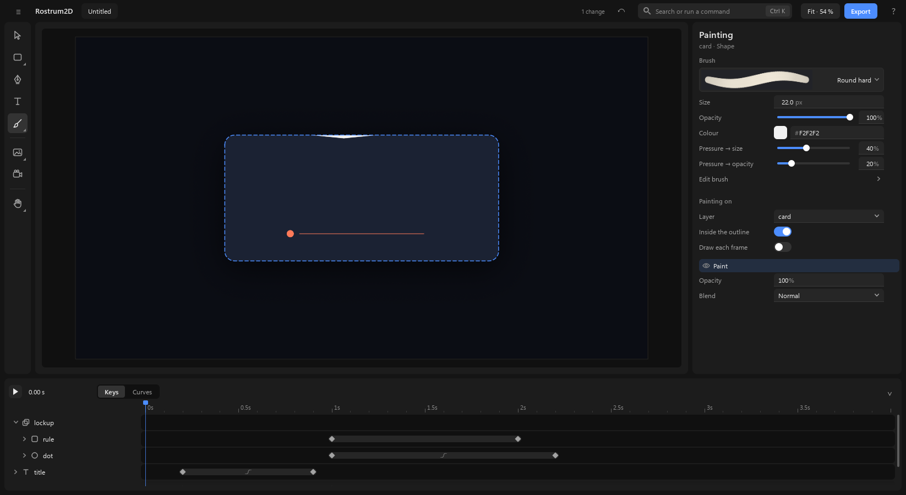
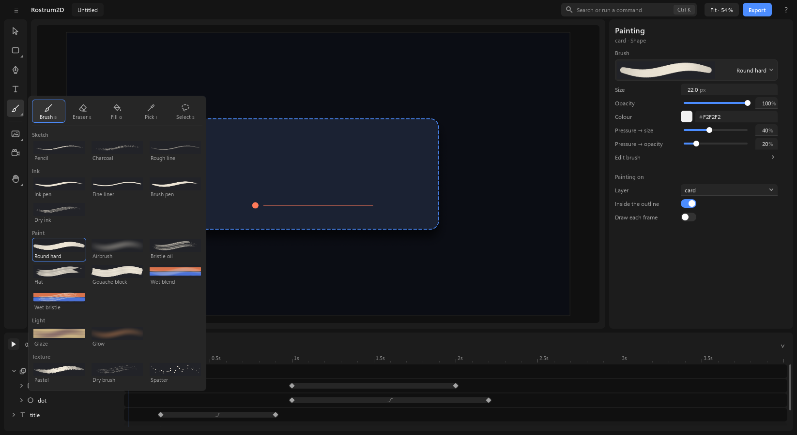
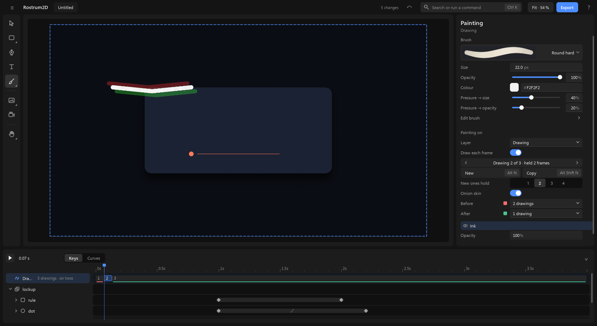
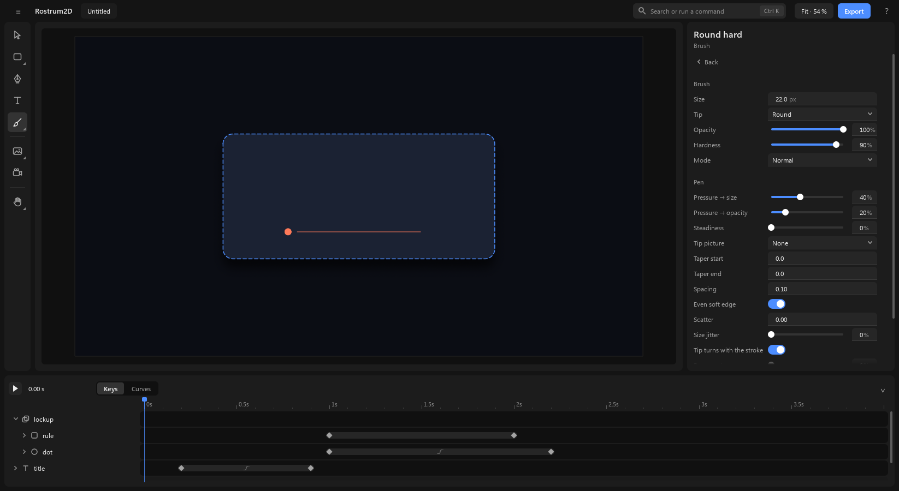

# Drawing

Paint by hand, and draw one picture after another for frame-by-frame animation. Painting is a **tool** you pick, not a page you go to: the same workspace stays, the right-hand panel becomes the brush, and nothing floats over the picture.

Paint always belongs to something. Paint on a shape, a text, a picture or a path and the paint becomes part of its look: it stays inside its outline, and it moves, turns, grows and fades with it. A **drawing** is simply paint with no outline around it.

## 1. Pick the brush

1. Click **Brush** in the tool rail (the column of icons at the left of the canvas), or press **B**. The **brush panel** opens beside the rail.
2. The top row of the panel holds the five paint tools:

   | Tool | Key | Does |
   |---|---|---|
   | **Brush** | B | paints |
   | **Eraser** | E | takes paint away (never the shape under it) |
   | **Fill** | G | fills a closed area (part 5) |
   | **Pick** | I | takes a colour from the picture |
   | **Select** | S | picks strokes to move, copy or delete (part 4) |

   Press a tool's key again to go back to the brush.
3. Under them are **19 brushes in five groups**: Sketch, Ink, Paint, Light and Texture. Each shows a real stroke of itself. Click one; it sets every brush setting but your colour.

4. What you paint on depends on what is picked:
   - **a shape, a text, a picture or a path**: the paint goes onto it, kept inside its outline. Strokes that go past the edge are simply not shown there. Its edge is drawn dashed so you can see what you are painting on.
   - **a drawing**: the paint goes onto the drawing.
   - **nothing**: **your first stroke makes a new drawing** and picks it. It is one step, so **Ctrl+Z** takes back the drawing and the stroke together.
5. **Esc** steps back one level at a time: first the brush panel closes, then picked strokes are let go, then you are back on Move. **V** goes straight to Move.

When the brush is on, the timeline shrinks to its compact height: the top strip, the ruler and only the drawing's own row. Click the button at the right end of the top strip to bring all the rows back; each tool remembers the height you last used with it.

## 2. The settings panel while you paint

The right-hand panel is headed "Painting", with the name and kind of what you paint on. There is no bar over the canvas; everything is here, never in two places.

1. **The brush row**: a stroke of the current brush and its name. Click it to open the brush panel again.
2. **The quick rows**: **Size**, **Opacity**, **Colour** (a swatch plus a hex box: click the swatch for the picker, or type `#rrggbb`), **Pressure → size** and **Pressure → opacity** for a pressure pen. The ink brushes also show **Steadiness**.
3. **Edit brush ›** opens every setting, with **‹ Back** to return. Only the settings that apply to the tip you chose are shown:

   - **Tip**: round, bristle (dry brush), chalk, flat, block, line.
   - **Hardness** and **Mode**: how crisp the edge is, and how the stroke meets what is there (multiply glazes, screen and add light up). Mode leaves out erase: that is the Eraser tool.
   - **Pen**: **Pressure → size**, **Pressure → opacity** and **Steadiness** (the line trails the pen and smooths a shaky hand). With a pen that tilts, **Tilt → angle** and **Tilt → size** appear. **Taper start** and **Taper end** make a stroke begin or end thin.
   - **Tip picture**: a picture as the tip's shape (sponge, speckle, streaks, ragged, charcoal, or one loaded into the project). It turns with the stroke.
   - **Spacing**, **Even soft edge**, **Scatter**, **Size jitter**, **Angle jitter**, **Tip turns with the stroke** and **Tip angle**.
   - **Paper grain** and **Paper** (tooth, canvas, cold press, laid, rough, or the project's own) with **Paper scale**: the paper's tooth breaks up the paint and stays put on the canvas.
   - **Colour drift** and **Hue drift**.
   - **Wet (smudge)**, **Wetness** and **Pick up layers below**: the brush drags the paint under it.
4. Under the brush, **Painting on** holds where the paint goes (part 6).

## 3. Draw a stroke

1. Press and drag on the picture, then let go. That is one stroke. **Ctrl+Z** takes back the last stroke.
2. **The brush ring.** The pointer is a ring the size of the brush, so you see what a stroke will cover.
3. Change the brush without leaving the canvas:
   - **[** and **]**: smaller and bigger.
   - **Shift+[** and **Shift+]**: softer and harder edge.
   - **Alt + right-drag**: left and right sizes, up and down softens.
   - **1** … **9** set the opacity to 10 … 90 %, **0** to 100 %.

### Pick a colour from the picture

Press **I**, or hold **Alt** while painting. The pointer becomes a picker, and a small round swatch beside it shows the colour of the picture under it, as you see it on screen (paint, shapes, pictures and all). Click, and that becomes the brush colour. Let go of **Alt** and you are painting again.

## 4. Select strokes, then move, copy, paste or delete them

1. Press **S** (or choose **Select**), then drag a loop round the strokes and fills you want; or hold **Ctrl** and drag while painting. Anything with most of its length inside the loop is picked, and outlined.
2. A small strip over the canvas shows **Copy**, **Paste** and **Delete**. Drag the picked strokes to move them; drag a corner of their box to scale them and the knob to turn them. They stay strokes, so they stay sharp.
3. **Ctrl+C** copies them and **Ctrl+V** pastes them a little down and right of the originals. **Delete** removes them. **Esc** lets go.

Each of these is one change, so **Ctrl+Z** takes back a move, a paste or a delete. Only paint layers that are not locked can be picked from.

## 5. Fill a closed shape

1. Draw the lines around an area, closed or nearly closed.
2. Press **G**, or choose **Fill** in the brush panel. The panel shows **Close gaps** (Small, Medium, Large) in place of Edit brush; the fill uses the brush's colour and opacity.
3. Click inside the area. It fills right up to the lines and a little under them, so no thin light edge shows between line and colour.
4. Lines that don't quite meet: pick **Medium** or **Large** under **Close gaps** and click again.
5. A click on a line, or in an area that is open to the edge of the painting, fills nothing and says why at the bottom.
6. The fill finds its edges in **all** the paint layers of the thing.
7. Press **G** again to go back to the brush.

A fill is kept as a shape, not as dots of colour, so it stays as sharp as your strokes. Each fill is one change: **Ctrl+Z** takes it back.

## 6. Painting on

Under the brush, **Painting on** shows:

1. **Layer ▾**: what the paint goes onto: the picked layer, other painted layers, or **New drawing**.
2. **Inside the outline**: on by default. Turn it off and the paint can spill over the whole box around the thing. (A drawing has no outline, so it does not have this switch.)
3. **Draw each frame**: off means the thing has one painting that holds the whole time. On means each frame can have its own drawing (part 7).
4. **The paint layers**, the top one first, once there is paint. A thing starts with one, called "Paint".
   - Click a layer's name to paint on it; it is highlighted.
   - The eye hides or shows it.
   - Drag a name up or down to change the order.
   - Right-click a name and pick **Delete** to remove it and its strokes.
   - **Opacity** and **Blend** under the list belong to the highlighted layer.

   Keeping lines above colour takes a second paint layer. Today that is made by an agent (`paint.stroke` with `layer: "new"`); there is no button for it yet. A second **drawing** layer works by hand (part 9).

## 7. Draw each frame: one drawing after another

Turn on **Draw each frame** under Painting on. The same panel grows the drawing tools:

1. **Drawing 2 of 3 · held 2 frames** with **‹** and **›** steps between the drawings. The **,** and **.** keys do the same.
2. **New** starts a blank drawing after this one (or at the playhead, on an empty frame). **Alt+N**. **Copy** starts it as a copy of this one, to change part of it. **Alt+Shift+N**.
3. **New ones hold** **1 · 2 · 3 · 4**: how many frames each new drawing lasts (2 is "on twos").
4. The **=** and **−** keys make the current drawing last more or fewer frames.

In the timeline the drawing's row shows its drawings as numbered cells; a drawing is held until the next cell. The number is its place in the row.

## 8. Onion skin

1. Turn on **Onion skin** under the drawing tools (or press **Alt+O**). The neighbouring drawings show faintly over the picture, so you can see where the last one was.
2. **Before** is tinted red and **After** green. Each has its own count: none, 1 drawing, up to 5 drawings.
3. Turn it off the same way. The faint pictures are for you only; they never appear in an export.

## 9. Play it, and more than one drawing layer

Press **Space**. The drawings play in order at the project's speed. **Preview size** makes playback lighter.

For two separate things you move apart, add a second drawing (choose **New drawing** under **Layer ▾**, or paint with nothing picked), then drag its name in the timeline. Each keeps its own drawings. Strokes go onto the layer that is picked, so click the name of the one you want to paint on.

Next: [the-screen.md](the-screen.md), and [exporting.md](exporting.md) to get a video file out.
