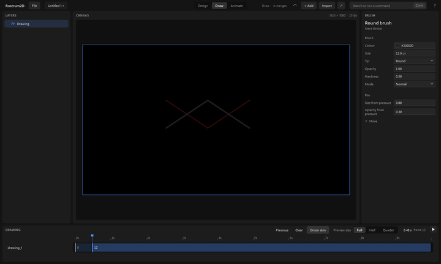

# Drawing

For a person using the Rostrum2D app. Paint by hand on a drawing layer, and draw one picture after another for frame-by-frame animation.

## 1. Add a drawing layer

1. Click **Draw** at the top.
2. Click **+ Add**. On this page the list has one choice: **Drawing**. Click it.
3. A layer called "Drawing" appears in Layers and is selected. Until a drawing layer is selected, the canvas says "Select a drawing layer to draw on it".

## 2. Choose your brush

On the Draw page the right-hand panel is called **Brush**. It sets how the next stroke looks.

1. **Colour**: click the swatch or type a colour.
2. **Size**: how wide the stroke is, in pixels.
3. **Tip**: the shape of the brush.
4. **Opacity**: how solid the stroke is.
5. **Hardness**: how crisp or soft its edge is.
6. **Mode**: how the stroke meets what is already there.
7. Under **Pen**, **Size from pressure** and **Opacity from pressure** say how much a pressure-sensitive pen changes the stroke. A mouse has no pressure.
8. **More** opens the rest. Only the settings that apply to the tip you chose are shown.

The brush's first colour is very dark. On the black background you will not see it. Change **Colour** before you draw.

## 3. Draw a stroke

1. Press and drag on the picture, then let go. That is one stroke.
2. Each stroke is one change, so **Ctrl+Z** takes back the last stroke.

## 4. Frames: one drawing after another

The strip along the bottom is called **Drawing**. It shows the drawing layer's frames on the ruler. A drawing starts at a mark and is held until the next one. The number on a bar is the frame where it starts.

1. Move the playhead to where you want the next picture (click the ruler).
2. Click **New drawing**. A blank picture starts there.
3. **New from this** starts the next picture as a copy of the one before. It is there only when there is something to copy.
4. **Previous** and **Next** step between drawings. **Alt+Left** and **Alt+Right** do the same.
5. **Hold longer** and **Hold shorter** make the current picture last more or fewer frames. **Alt+Up** and **Alt+Down** do the same.
6. **Clear** empties the current picture.
7. These buttons show only when they can apply. For example, there is no **New drawing** where a drawing already starts.

## 5. Onion skin

1. Click **Onion skin** (or press **Alt+O**). The neighbouring drawings show faintly over the picture, so you can see where the last one was. The ones before are tinted red and the ones after are tinted green.
2. Click it again to turn it off. The faint pictures are for you only; they do not appear in an export.

## 6. Play it

Press **Space**. The pictures play in order at the project's speed. **Preview size** makes playback lighter.

Next: [the-screen.md](the-screen.md), and [exporting.md](exporting.md) to get a video file out.
