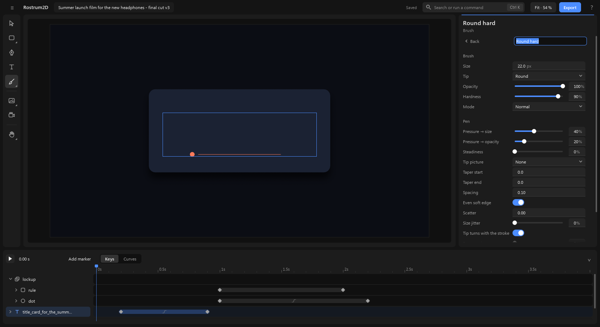
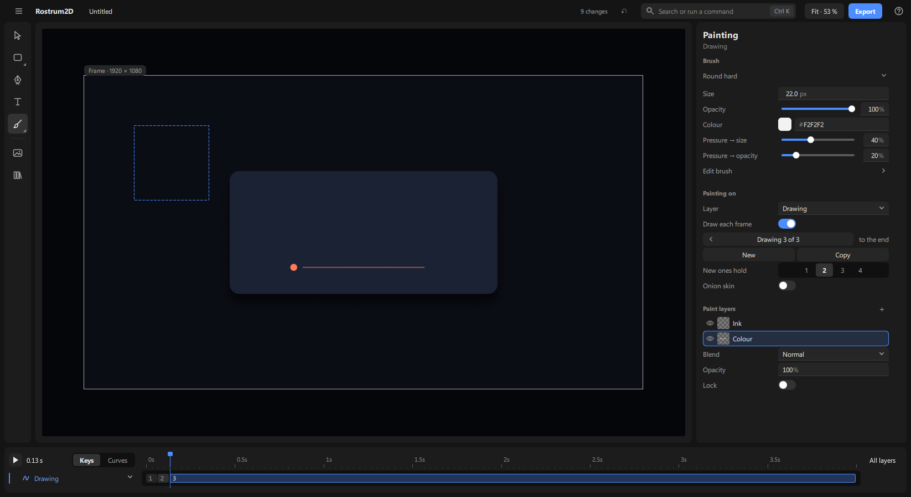

# Drawing

Paint by hand, and draw one picture after another for frame-by-frame animation. Painting is a **tool** you pick, not a page you go to: the same workspace stays, the right-hand panel becomes the brush, and nothing floats over the picture.

Paint always belongs to something. Paint on a shape, a text, a picture or a path and the paint becomes part of its look: it stays inside its outline, and it moves, turns, grows and fades with it. A **drawing** is simply paint with no outline around it.

## 1. Pick the brush

1. Click **Brush** in the tool rail (the column of icons at the left of the canvas), or press **B**. The **brush panel** opens beside the rail.
2. The top row of the panel holds the five paint tools:

   | Tool | Key | Does |
   |---|---|---|
   | **Brush** | B | paints |
   | **Eraser** | E | takes paint away from what you paint on (never the shape under it). With nothing painted picked there is nothing to erase: the pointer shows a no-entry sign and a press does nothing (it never makes a new drawing) |
   | **Fill** | G | fills a closed area (part 5) |
   | **Pick** | I | takes a colour from the picture |
   | **Select** | S | picks strokes to move, copy or delete (part 4) |

   Rest the pointer on a tool to see its name and key. Press a tool's key again to go back to the brush.
3. Under them are **19 brushes in five groups**: Sketch, Ink, Paint, Light and Texture. Each shows a real stroke of itself; rest the pointer on one and its stroke shows larger. Click one; it sets every brush setting but your colour.
4. Last come **My brushes**: the brushes you saved, from this project and from your own library (see "Save your own brush" below). A brush kept in only one of the two says which, small, on the corner of its stroke: **project** or **library**. Right-click one for what you can do with it: **Rename** (type, then Enter), **Duplicate** (a copy named "… copy", to change without losing the first), **Also keep in my library** or **Also keep in this project** (when it is only in one), **Remove from this project** or **Remove from my library** (when it is in both), and **Delete** (gone from both).

5. What you paint on depends on what is picked:
   - **a shape, a text, a picture or a path**: the paint goes onto it, kept inside its outline. Strokes that go past the edge are simply not shown there. Its edge is drawn dashed so you can see what you are painting on.
   - **a drawing**: the paint goes onto the drawing.
   - **nothing**: **your first stroke makes a new drawing** and picks it. It is one step, so **Ctrl+Z** takes back the drawing and the stroke together.
6. **Esc** steps back one level at a time: first picked strokes are let go, then you are back on Move (the brush panel closes with the Brush, however you opened it). **V** goes straight to Move.

When the brush is on, the timeline shrinks to its compact height: the header row and only the drawing's own row. Click the button at the right end of the ruler to bring all the rows back; each tool remembers the height you last used with it.

Paint only goes on a layer you can see. If the layer is hidden, or has no opacity at the playhead, the stroke is refused and the top bar says so ("title isn't showing at 2.4 s"): show it, or move the playhead to where it shows.

## 2. The settings panel while you paint

The right-hand panel is headed "Painting", with the name and kind of what you paint on. There is no bar over the canvas; everything is here, never in two places.

1. **The brush name** (Brush and Eraser only): the current brush's name as a plain label. Click it to open the brush panel again: that panel is the one place a brush is chosen. Each tool shows only what it uses: the Eraser has no Colour, Fill shows Colour and Close gaps only, and Pick and Select show no brush settings at all (Select's Copy, Paste and Delete are in the bar over the strokes).
2. **The quick rows**: **Size**, **Opacity**, **Colour** (a swatch plus a hex box: click the swatch for the picker, or type `#rrggbb`), **Pressure → size** and **Pressure → opacity** for a pressure pen. The ink brushes also show **Steadiness**. On a short window (under 800 px high, such as 1280×720) the two pressure rows are not in the quick rows: they stay under **Edit brush ›**, and the rows below sit a little closer so the whole panel, down to **Lock**, fits without scrolling.
3. **Edit brush ›** opens every setting, with **‹ Back** to return. Only the settings that apply to the tip you chose are shown:

   - **Tip**: round, bristle (dry brush), chalk, flat, block, line.
   - **Hardness** and **Mode**: how crisp the edge is, and how the stroke meets what is there (multiply glazes, screen and add light up). Mode leaves out erase: that is the Eraser tool.
   - **Pen**: **Pressure → size**, **Pressure → opacity** and **Steadiness** (the line trails the pen and smooths a shaky hand). With a pen that tilts, **Tilt → angle** and **Tilt → size** appear. **Taper start** and **Taper end** make a stroke begin or end thin.
   - **Tip picture**: a picture as the tip's shape (sponge, speckle, streaks, ragged, charcoal, or one loaded into the project). It turns with the stroke.
   - **Spacing**, **Even soft edge**, **Scatter**, **Size jitter**, **Angle jitter**, **Tip follows stroke** and **Tip angle**. Spacing and Scatter are a share of the tip (10 % = dabs a tenth of the tip apart); Taper start and end are in tip sizes (2 × size = thin over two tip widths).
   - **Paper grain** and **Paper** (tooth, canvas, cold press, laid, rough, or the project's own) with **Paper scale**: the paper's tooth breaks up the paint and stays put on the canvas.
   - **Colour drift** and **Hue drift**.
   - **Wet (smudge)**, **Wetness** and **Pick up layers below**: the brush drags the paint under it.
4. Under the brush, **Painting on** holds where the paint goes (part 6).

### Save your own brush

Once a brush is how you like it, click **+ Save this brush**: at the right of **‹ Back** on Edit brush, or the last tile under **My brushes** in the brush panel. A name box opens in place with the brush's name; type a name and press **Enter** (**Esc** leaves it). The brush joins **My brushes** with a stroke of itself, and it is the brush you paint with. It keeps every setting but the colour, including a tip picture or paper you loaded. A saved brush is kept in two places: in the project, so agents working on it see and use the same ones, and in your own library, so it is in **My brushes** in every project you open. A tip picture or paper you loaded goes into your library with it, so the brush paints the same in another project (the picture is copied into that project when you pick the brush). The right-click menu takes it out of either place. With no project open, it goes into your library alone.

## 3. Draw a stroke

1. Press and drag on the picture, then let go. That is one stroke. **Ctrl+Z** takes back the last stroke.
2. **The brush ring.** The pointer is a ring the size of the brush, so you see what a stroke will cover.
3. Change the brush without leaving the canvas:
   - **[** and **]**: smaller and bigger.
   - **Shift+[** and **Shift+]**: softer and harder edge.
   - **Alt + right-drag**: left and right sizes, up and down softens.
   - **1** … **9** set the opacity to 10 … 90 %, **0** to 100 %.

### Pick a colour from the picture

Press **I**, or hold **Alt** while painting. The pointer becomes a picker, and a small round swatch beside it shows the colour of the picture under it, as you see it on screen (paint, shapes, pictures and all). Click, and that becomes the brush colour. Let go of **Alt** and you are painting again.

## 4. Select strokes, then move, copy, paste or delete them

1. Press **S** (or choose **Select**), then drag a loop round the strokes and fills you want; or hold **Ctrl** and drag while painting. Anything with most of its length inside the loop is picked, and outlined.
2. A small strip over the canvas says how many strokes are picked and shows **Copy** and **Delete**; **Paste** joins them only after you have copied something. Drag the picked strokes to move them; drag a corner of their box to scale them and the knob to turn them. They stay strokes, so they stay sharp.
3. **Ctrl+C** copies them and **Ctrl+V** pastes them a little down and right of the originals; the pasted copy shows at once in flat colour, then in its true brush look a moment later, and is what stays picked, so **Delete**, a drag or a turn acts on it, not on the original. **Delete** removes the picked strokes. A single straight stroke can be picked and dragged too. **Esc** lets go.

Each of these is one change, so **Ctrl+Z** takes back a move, a paste or a delete. Only paint layers that are not locked can be picked from.

## 5. Fill a closed shape

1. Draw the lines around an area, closed or nearly closed.
2. Press **G**, or choose **Fill** in the brush panel. The panel shows **Close gaps** (Small, Medium, Large) and **Colour** (no Size, Opacity or Pressure: they don't apply); the fill uses the brush's colour.
3. Click inside the area. The area turns the brush's colour at once; a moment later (a second or two on a big drawing) the exact fill replaces it. It fills right up to the lines and a little under them, so no thin light edge shows between line and colour.
4. Lines that don't quite meet: pick **Medium** or **Large** under **Close gaps** and click again.
5. A click on a line, or in an area that is open to the edge of the painting, fills nothing and says why in plain words in the top bar ("This area has a gap. Try Medium or Large under Close gaps.").
6. The fill finds its edges in **all** the visible paint layers of the drawing, so you can fill "Colour" up to the lines of "Ink". A locked layer refuses a fill.
7. Press **G** again to go back to the brush.

A fill is kept as a shape, not as dots of colour, so it stays as sharp as your strokes. Each fill is one change: **Ctrl+Z** takes it back.

## 6. Painting on

Under the brush, **Painting on** shows:

1. **Layer ▾**: what the paint goes onto: the picked layer, other painted layers, or **New drawing**.
2. **Inside the outline**: on by default. Turn it off and the paint can spill over the whole box around the thing. (A drawing has no outline, so it does not have this switch.)
3. **Draw each frame**: off means the thing has one painting that holds the whole time. On means each frame can have its own drawing (part 7). The switch works before anything is painted: the first stroke then makes drawing 1 at the playhead. Its hover help stands beside the panel, wrapped, so it never hides the rows under it.
   (On every switch in the panels, clicking its words flips it too, not only the switch itself.)
4. **Paint layers +**. A thing starts with one paint layer, called "Paint", so at first this is one line with its **+**. To keep lines above colour, press **+**: a new layer, "Paint 2", goes on top and is highlighted, and your next stroke or fill goes into it. With two or more, the list shows, the top one first. Each row has an eye, a small picture of that layer's paint (on grey squares, so white ink shows as well as black) and its name; in grey its blend and opacity when they are not Normal · 100 % ("Multiply · 70 %"), and a lock when it is locked.
   - Click a row to paint on that layer; it is highlighted in blue.
   - The eye hides or shows it.
   - Drag a row up or down to change the order.
   - Double-click a name to rename it.
   - Right-click a row: **Hide**, **Lock**, **Rename**, **Duplicate**, **Delete**. Duplicate puts a copy with all its strokes just above, named "… copy", and highlights it; Delete removes the layer and its strokes.
   - Under the list, the highlighted layer's own **Blend** (Normal, Multiply, Screen, Add), **Opacity** and **Lock**. A locked layer refuses paint and fill, and says so in the top bar ("Paint 2 is locked. Turn off its Lock to paint on it."): lock the line art before you colour under it. Click the lock on its row to unlock it.

   Every one of these is one change, so **Ctrl+Z** takes back exactly one. In a thing that draws each frame, the paint layers belong to the thing and are shared by all its drawings (part 7): **+**, rename, order, eye, lock, blend, opacity, Duplicate and Delete act on every drawing at once. Each drawing keeps its own strokes in each layer.

## 7. Draw each frame: one drawing after another

Turn on **Draw each frame** under Painting on. The same panel grows the drawing tools:

1. **Drawing 2 of 3** with **‹** and **›** steps between the drawings (the **,** and **.** keys do the same), and how long this drawing holds at its right (**2 frames**, or **to the end** on the last one).
2. **New** starts a blank drawing after this one (or at the playhead, on an empty frame), with the same paint layers, empty (hover it for its key, **Alt+N**). **Copy** starts it as a copy of this one, its strokes in the same paint layers, to change part of it (**Alt+Shift+N**).
3. **New ones hold** **1 · 2 · 3 · 4**: how many frames each new drawing lasts (2 is "on twos").
4. The **=** and **−** keys make the current drawing last more or fewer frames.

**Paint layers across drawings.** The paint layers are the same in every drawing, so a common way to work is:

1. Draw the lines: a new drawing's first paint layer is "Ink". Press **Paint layers +**, drag the new layer below "Ink", and rename it "Colour" (right-click › Rename, or double-click its name).
2. Lock "Ink" (right-click › Lock), so colour can't land on the lines.
3. Fill or paint on "Colour" up to the lines.
4. Step to the next drawing with **.** The highlighted layer stays "Colour", so you can colour drawing after drawing without picking it again.
5. **Clear paint** and strokes stay per drawing; hiding, locking and the rest apply to all drawings.

The onion skin (next part) still shows the whole drawings before and after.

In the timeline the drawing's row shows its drawings as numbered cells; a drawing is held until the next cell. To repeat a hand-drawn cycle (a walk, a flicker), set the layer's **Loop** (in its Timing settings) to **Loop** or **Ping-pong**: the drawings repeat for the layer's whole length, and the repeats show as fainter cells on the row (they follow the drawings, so change a drawing and every repeat changes). Agents: `set drawing_1 loop "loop"` (`off`, `loop`, `pingpong`). The last drawing is held as long as the one before it. The number is its place in the row; a cell too narrow to show it whole has none, and hovering it says "Drawing 3" (zoom the timeline in to see them). When the drawing itself is animated (moved, turned), its keys sit as diamonds on top of the cells: click a diamond for the key, the cell around it for the drawing. Open the row (its ›) to see each animated setting on its own line.

## 8. Onion skin

1. Turn on **Onion skin** under the drawing tools (or press **Alt+O**). The neighbouring drawings show faintly over the picture, so you can see where the last one was.
2. **Show before** is tinted red and **Show after** green. Each has its own count: none, 1 drawing, up to 5 drawings.
3. Turn it off the same way. The faint pictures are for you only; they never appear in an export.

## 9. Play it, and more than one drawing layer

Press **Space**. The drawings play in order at the project's speed. **Preview size** makes playback lighter.

For two separate things you move apart, add a second drawing (choose **New drawing** under **Layer ▾**, or paint with nothing picked), then drag its name in the timeline. Each keeps its own drawings. Strokes go onto the layer that is picked, so click the name of the one you want to paint on.

Next: [the-screen.md](the-screen.md), and [exporting.md](exporting.md) to get a video file out.
