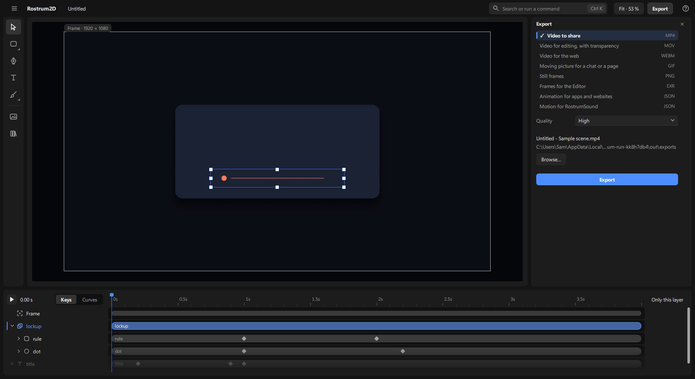
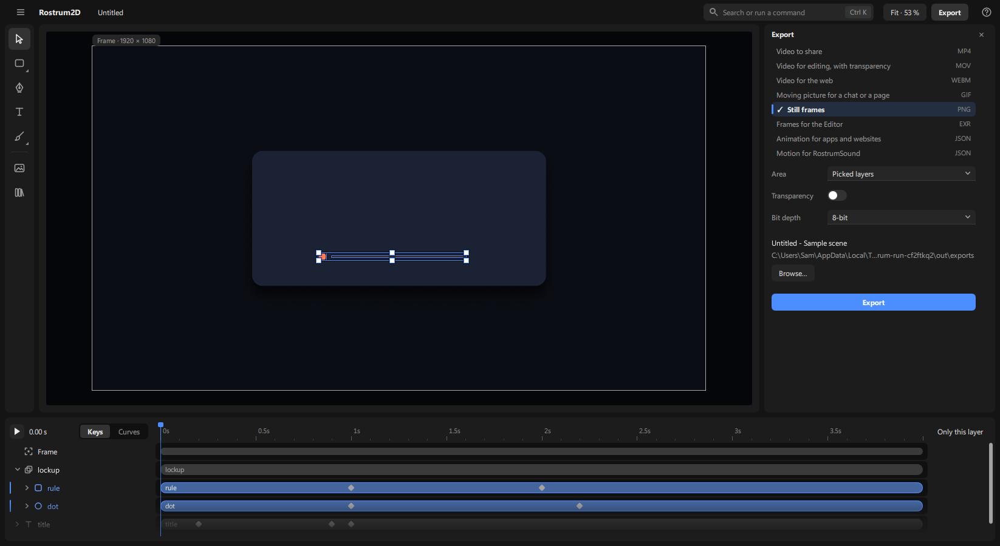

# Exporting a video

Turn your project into a video, pictures or another file you can share or hand on. The export is made the same way the picture on the canvas is drawn, so what you see is what you get. Layers you have hidden (the eye at the right of their name in the timeline) are left out.

## 1. Open the Export panel

1. Click **Export** at the top right (or press **Ctrl+E**). The **Export** panel opens at the right of the canvas.
2. Click **Export** at the top again, or the × at the panel's top right, to put it away.

## 2. Pick what it is for

The panel lists what each export is for, with its file type at the right. Click one:

- **Video to share** (MP4): a normal video that plays almost anywhere. Good for sharing and for most video editors. It cannot carry transparency.
- **Video for editing, with transparency** (MOV, ProRes 4444): a high-quality video that keeps transparency. Big files. For handing to a video editor.
- **Video for the web** (WEBM): a video for web pages. Can keep transparency.
- **Moving picture for a chat or a page** (GIF): a small looping picture. Limited colours, no sound. It starts at half the size and 15 frames a second, so a 4-second full-HD scene comes out well under 1 MB for flat motion graphics (a full-size GIF at the scene's rate is many times that).
- **Still frames** (PNG): one picture for every frame, in a folder. Keeps transparency. It also has an **Area**: **Frame** (the default: what the frame shows, as every export), **Picked layers** (only offered while layers are picked: the box round them in the world, a logo as a PNG) or **Everything** (every layer and the frame's whole path). An area is one world rectangle for the whole range, taken at the first picture, drawn at one picture px per world px. Pick one frame as the range for a single still. Agents: `render_export format=png time=3 area=items ids=[…] scale=0.5` (`time` = one picture; `scale` = picture px per world px, at most 8192 px a side; video, GIF and Lottie are always the frame).

  
- **Frames for the Editor** (EXR): one picture for every frame, made to be opened in Rostrum Editor.
- **Animation for apps and websites** (JSON, Lottie): moving graphics for apps and web pages. It cannot carry everything. After the export, the panel lists what it left out under "Lottie couldn't carry". A solid fill's opacity (and its keys) is carried; a file saved before fill opacity existed exports as fully opaque, as before. PSD is for bringing files in only: the app has no PSD export.
- **Motion for RostrumSound** (JSON): not a picture. It is the movement of your layers, for placing sounds against.

## 3. Settings

Only the settings that apply to the chosen format are shown.

1. **Quality** (MP4): **Standard**, **High** or **Best**. **High** (the default) looks the same as **Best** at normal size and is about a third of its size on a grainy picture; **Standard** is smaller still and smooths fine film grain; **Best** is for handing the file to someone who will grade it again. Flat graphics stay small on all three; only a busy, grainy picture makes a big file (a 15 s 1080p grainy piece: about 9, 35 and 108 MB).
2. **Transparency**: a switch for formats that can keep it. Turn it on to keep see-through areas see-through.
3. **Size** and **Frame rate** (GIF): **Full size**, **Half size** (the default) or **480 px wide**; **15 frames a second** (the default) or **The scene's rate**. Below them one line, **File**, says what they come to: about how big the file will be, its pixel size and how long it plays, such as "about 0.3 MB · 960×540 · 10 s at 15 fps" (a GIF stores identical neighbouring pictures once, so it says its length, which is exact, never a picture count). The size is measured, not guessed: the app draws a few frames in the background and makes a small GIF of them, so it says "Working out the size…" for a few seconds first. A drawing held for several frames or a still background costs almost nothing; a moving full-screen gradient costs a lot. After you export, this line goes and the result line below **Export** says the same facts for the real file. One palette for the whole GIF and a fixed dither pattern keep it small; it never makes the GIF larger than the scene or faster than the scene.
4. **Bit depth** (PNG): how finely colour is kept, **8-bit** or **16-bit**.
4. **Include the project's sound** (MP4 only, and only when the project has sound): a switch.
5. **Range**: a picker at the top of the sheet, above the list of formats (for the formats that play over time). **Everything** (with the length in seconds) is the first choice; then **Work area** (once you have set one on the ruler: right-click the ruler, see [the-screen.md](the-screen.md) › Markers); then the stretches between your markers, one for each pair of neighbouring markers, such as "intro → drop"; last **From – to…**: pick it and two boxes, **From** and **To** (seconds), appear first under the list of formats; type or drag them. Agents give the same part as `start` and `end` on `render_export`.
6. **Scene**: when the project has more than one scene, a picker below the list of formats, first of the settings. It starts on the scene the window shows (showing another scene changes it too).

## 4. Where the file goes

1. Under the settings you see the file's name and its folder. The name is a box: click it and type the name you want (the file type stays after it; what a file name can't hold is dropped; empty goes back to the usual name). The folder shows exactly where the file will land, the new version folder included (`…\renders\main\v001`). Agents give the same name as `name` on `render_export`. Left alone, the file is named after the item you worked in ("loop.mp4"), with the composition's name after it only when the item has several compositions or the composition has a name of its own ("Title walk - Credits.mp4"). A new project's first item, "main", takes the project's name. A project that has its own folder saves inside it, in its own new version folder, so an export never replaces an earlier one.
2. A document that is not a saved project yet (for example the built-in sample) saves into your **Videos** folder, or your Documents folder if you have no Videos folder. It is never hidden away in a cache. A long folder path is shortened in the middle on one line; hover it to read the whole path.
3. To choose another place, click the folder and type it (the whole path, like `C:\Users\me\Videos\Ads`), then Enter: a folder that isn't there yet is made; one that can't be made turns red and says why; Esc puts the old folder back. Or click **Browse…** and pick a folder. **Renders folder** (shown once you have picked another) goes back to the usual place.
4. If a file with that name is already there, the app asks "… is already there" with **Cancel**, **Keep both** (the new one gets a number) and, for single files, **Replace**. A folder of frames can't be replaced.

## 5. Export

1. Click **Export**. A progress bar runs (for Lottie it moves layer by layer; a Lottie file takes well under a second for most scenes), and **Cancel** appears beside it while it works.
2. When it finishes, the panel says **Exported** and the file's real name (for a run of pictures: how many, and the first and last, such as "48 pictures, Scene_0001.png to Scene_0048.png"), with **Play** and **Show in folder**. One line above it says the file as written: its size on disk, its pixel size and its frames, such as "0.2 MB · 960×540 · 150 frames at 15 fps" (a GIF says its length instead: "0.2 MB · 960×540 · 10 s at 15 fps"). Only what that line and the settings above don't already say is listed under the settings (for an MP4: how it was encoded). Change a setting and the result line goes, because it no longer describes what **Export** would make.
3. Click **Show in folder** to open where it went. The top bar's chip says **Exported Main.mp4 ▾** too, until your next change: click it for **Play** and **Show in folder** after the panel is closed.
4. If something goes wrong the panel and the top bar say so in red, in plain words: what could not be saved and why, such as "Couldn't save the file: this computer won't let Rostrum write to …. Pick another folder." (the full technical line goes to the console, for agents and logs). Nothing is reported as done unless the file was made.
5. A scene with nothing showing (no layer, or every layer hidden; the frame alone draws nothing) is not exported: the panel says "There is nothing to export yet: the scene has no layers showing. Add one first." and no file is made. Agents get the same refusal from `render_export`.
6. **Ctrl+Shift+E** exports again with the last settings without opening the panel. Before your first export in this window there are no last settings: the top bar says "Nothing exported yet — Ctrl+E to export".

## 6. How long it takes

1. The app draws several frames at once on your graphics card (three on a laptop with 8 processor threads) and writes the MP4 with the card's own video encoder, so a simple film exports in about its own length or less.
2. What makes an export slow is work repeated in every frame: **motion blur** draws each frame several times (its **Samples**), and big blurs, glows and depth of field over the whole picture cost the most. A 28-second film full of glowing, blurred flowers with 4 samples takes several minutes.
3. The export never lowers quality to go faster: the file shows exactly what the canvas shows.
4. Agents: the result of `render_video` lists where the time went (`timing`: drawing, layout, encoding) and how many workers drew (`workers`). It (and `render_export`'s for an mp4) also checks the finished file for **blank, washed-out and unchanged stretches** and for subjects cut by the frame edge (about every half second, a few seconds of work) and names them with times and numbers, for example "12–13.4 s: near-empty, at most 2 % of the frame differs from its background (the last frame: the ending)"; the same check on any composition or mp4 is `look_frame` `what: "empty"` (`start`, `end`, `every`, `min_still`, `video`). It reports facts, not faults: a held title or a planned quiet beat is yours to judge; look at a named time with `look_frame`. To look at the finished film itself, not the composition: `look_frame` `what: "sheet"` with `video` = the mp4's path (`render_video`'s `video`), `start` / `end` / `count` (or `times: [..]`) in the film's seconds; its tiles are the file's own frames. The reply ends with the next step: a fix pass (look, name the three weakest moments, fix them, export again to the same name) and, when the video is silent, how to put music under it from RostrumSound (`run_open_project` on the same folder, `run_script`, `run_set_main_mix`; the next export carries the mix).
5. An export never waits forever. If one frame takes over 2 minutes (the drawing engine stuck), the export stops, the
   engine is ended, and the error names the frame, such as "stuck at frame 183 (6.10 s)". Look at that moment with
   `look_frame`. Drawing a single picture has the same limit.
6. Agents: `inspect_job` shows frames done of total and how long since the last one (`last_step_s_ago`), so a slow frame
   is visible while it runs. `run_stop` stops a render at once, even mid-frame, and works on a render another session
   or server started (that program stops it within a few seconds); `inspect_job` with no id lists those too. The app
   holds no lock between programs: a render that ended or was stopped leaves nothing that blocks the next one.

Next: [first-animation.md](first-animation.md), [files.md](files.md).
