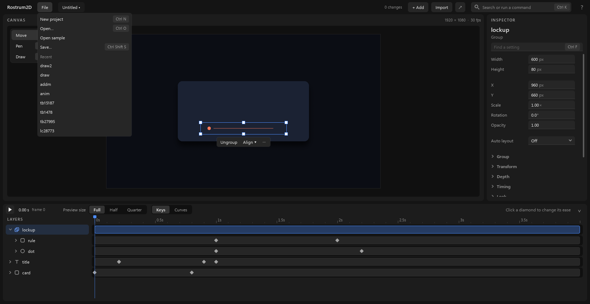

# Files and settings

Starting, saving and opening projects, and what happens when you close with changes not saved.

## 1. The File menu

Click **File** at the top left.

- **New project** (Ctrl+N): a fresh, empty project.
- **Open…** (Ctrl+O): pick a project to open.
- **Open sample**: a small example project to look around in. It is made fresh each time and is not saved until you save it.
- **Save** (Ctrl+S): keeps your changes. It is in the menu only while there is something to save.
- **Save as…** (Ctrl+Shift+S): keeps a copy of the project under a name you type.
- **Recent**: under this heading are the projects you opened last. Click one to open it.

The same actions are in the command box (**Ctrl+K**).

## 2. A project is a folder

1. Each project is a folder. It holds your work, your exports and your markers together.
2. New projects go in `Documents\Rostrum2D`. **Save as…** also makes its new folder there.
3. A new project is called "Untitled 1", "Untitled 2" and so on until you give it a name. It already has its folder, so **Save** keeps it there under that name.

## 3. The unsaved dot

1. Next to the project's name at the top is a small dot while you have changes that are not saved yet.
2. Press **Ctrl+S**, or choose **Save** in the File menu. The dot goes away.

## 4. Name a project

1. Choose **Save as…** in the File menu.
2. A box asks for a name and says that a new project folder is made in your Rostrum2D folder. It starts with a suggested name, which you can change.
3. Type a name and click **Save**. The new project opens in its own window, with your changes in it. **Cancel** changes nothing.

## 5. Open a project

1. Choose **Open…**, then pick the project in the window that opens. It starts in your Rostrum2D folder.
2. Or choose one from **Recent** in the same menu.
3. The project opens in its own window.

## 6. If the computer stops before you save

1. While you have unsaved changes, the app keeps a recovery copy for you about once a minute. It never replaces your saved project.
2. Next time you open that project, a question appears: **Restore unsaved changes?** It says when the copy was made.
3. **Restore** brings the changes back. **Discard** throws the copy away.

## 7. Closing with unsaved changes

When you close the window, or use **New project**, **Open…** or **Open sample**, with unsaved changes, the app asks **Save changes to** your project's name:

- **Save**: keeps the changes, then carries on.
- **Don't save**: throws the changes away, then carries on.
- **Cancel**: stays where you are.

## 8. If someone else saved it first

If an agent or another window saved the same project after you opened it, **Save** will not write over theirs. It says so. Use **Save as…** to keep your version as a new project. An agent's changes and yours are kept apart: **Ctrl+Z** takes back only your own steps.

Next: [first-animation.md](first-animation.md), [exporting.md](exporting.md).
