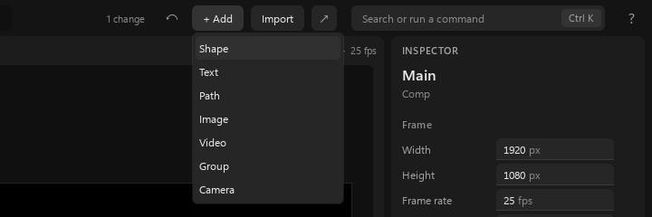
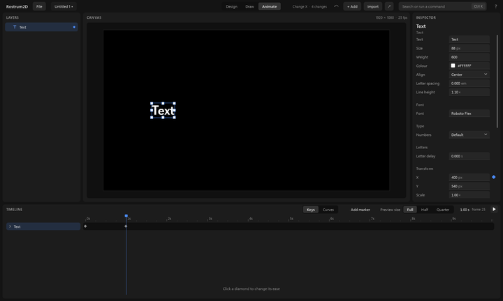

# Making your first animation

For a person using the Rostrum2D app. This page takes you from an empty project to something that moves, and shows you how to take a step back.

## 1. Start a new project

1. Click **File** at the top left, then **New project** (or press Ctrl+N).
2. The project opens with an empty black picture, called "Untitled 1". The three pages at the top are **Design**, **Draw** and **Animate**. You start on **Design**.
3. The panel on the left is **Layers**. It says "Add a shape, text or picture with + Add" until you add something.

## 2. Add text and a shape

1. Click **+ Add** at the top. A short list opens: **Shape**, **Text**, **Path**, **Image**, **Video**, **Group** and **Camera**.

2. Click **Shape**. A white square appears in the middle of the picture, and a row called "Shape" appears in Layers.
3. Click **+ Add** again and choose **Text**. A word appears in the middle. It is white, like the square, so you may need to move one of them to see both.
4. The newest layer is selected. Its name is at the top of the panel on the right, which is the **inspector**.

## 3. Select and change something

1. Click a layer's row in **Layers**, or click the thing itself in the picture. Small squares appear round it.
2. The inspector shows only the settings that apply to what you picked. Text has a **Text** box and a **Size**; a shape has **Width** and **Height**.
3. Click the **Text** box in the inspector and type your own words, for example "Hello". Press Enter.
4. To move a layer, drag it in the picture. Or type a number into **X** or **Y** under **Transform**.
5. To rename a layer, double-click its name in Layers, type, and press Enter.

## 4. Go to a moment in time

1. The strip along the bottom is the time ruler. It shows seconds: 0s, 1s, 2s and so on. The blue marker is the **playhead**, the moment you are looking at.
2. Click on the ruler, or drag along it, to move the playhead. The time shows beside it, for example "1.00 s".
3. Click **Animate** at the top. The bottom strip becomes a **Timeline** with one row for each layer.

## 5. Make a value animate

A value moves over time when it has **keys**. A key is a small diamond that remembers the value at one moment.

1. Select your text layer. Move the playhead to 0 seconds.
2. In the inspector, find **X**. At the right edge of its row is a diamond, faint until you hover the row. Click it. It fills in, and a key is saved at 0 seconds.
3. Move the playhead to 1 second.
4. Change **X**: type a new number and press Enter, or drag the text in the picture. A second key appears at 1 second by itself.

5. The diamond beside a value tells you its state:
   - **Filled**: there is a key at the playhead.
   - **Outlined**: the value is animated, but there is no key at this moment.
   - **Faint, only when you hover**: it is not animated yet. Click it to start.
6. The same keys show as diamonds on the layer's row in the **Timeline**.

## 6. Play it

1. Press **Space**, or click the play button, to play from the playhead. Press Space again to stop.
2. **Preview size** (**Full**, **Half**, **Quarter**) next to the play button makes playback lighter on a slow computer. It does not change what you export.

## 7. Undo a mistake

1. Press **Ctrl+Z** to take back the last change. **Ctrl+Shift+Z** (or **Ctrl+Y**) brings it back.
2. The undo and redo arrows near the top do the same. They only appear when there is something to undo or redo. Hover one to read what it would take back.
3. The line next to them says what you did last, and how many changes you have made since you opened the project.

Next: [the-screen.md](the-screen.md) to learn every part of the window, [drawing.md](drawing.md) to draw by hand, and [exporting.md](exporting.md) to get a video file out.
