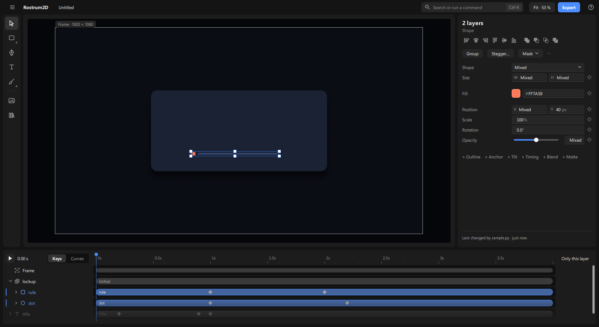

# Making your first animation

This page takes you from an empty project to something that moves, and shows you how to take a step back. There is one workspace and no pages to switch between: the picture is in the middle, the settings of what you picked are on the right, and the timeline, which is also the list of your layers, runs along the bottom.

## 1. Start a new project

1. Click **≡** at the top left, then **New** (or press Ctrl+N).
2. An empty black picture opens, called "Untitled 1". Its size and speed are in the settings panel, for example "1920 × 1080 · 25 fps".
3. With nothing picked, the panel on the right shows the picture's own settings: **Width**, **Height**, **Frame rate**, **Length** and **Background**. Change them here if you need a different size or length.

## 2. Add text

1. Making things lives in the **tool rail**, the column of icons at the left of the canvas: **Shapes**, **Pen**, **Text**, **Brush**, **Media** (pictures, video, files), **Camera**.

2. Press **T**, then click on the picture where the words go and type. A row appears in the timeline at the bottom. **Esc** or **Ctrl+Enter** ends the typing, and the text stays picked, so the panel on the right shows its settings.
3. In the panel, change **Size**, **Weight** and **Colour** (a swatch plus a hex box) in the short list.

## 3. Pick, move and change things

1. Click a thing in the picture, or its name in the timeline, to pick it. Small squares appear round it.
2. Drag it to move it. Drag a square on its edge to resize it. The arrow keys nudge the picked layers by 1 pixel, and **Shift** with an arrow by 10. Each press is one change you can undo.
3. The panel on the right shows a few essential settings first (for text: the words, size, weight, colour, position, opacity). The rest are in named groups below them, such as **Text**, **Font** and **Outline**. Click a group's name to open it, and again to fold it.
4. Not sure where a setting is? Click **Find a setting** at the top of the panel (or press **Ctrl+F**), type a word such as "opacity", and pick the setting from the list. Its group opens and it is shown to you. A word such as "blur" names an effect: it shows a line **Add Blur**, and the effect's settings appear under **Effects** once it is added.
5. A setting appears only when it can be used. Turn something on and the settings that go with it appear; turn it off and they go. Nothing sits there greyed out.
6. To rename a layer, double-click its name in the timeline (or press **F2**) and type.

## 4. The timeline is the layers list

1. The names on the left of the timeline are your layers, newest on top. The bar beside each name shows when that layer is on screen. A new layer's bar runs the whole length.
2. Drag the middle of a bar to show the layer later or earlier. Drag an end of the bar to start it later or end it sooner. A bar snaps to the playhead and to markers (see [the-screen.md](the-screen.md)).
3. The ruler above the bars counts seconds. The blue marker is the **playhead**, the moment you are looking at. Click or drag on the ruler to move it. The time shows beside the play button, for example "1.00 s".

## 5. Make a value move, right where you are

A value moves over time when it has **keys**. A key is a small diamond that remembers the value at one moment. You do not need another page for this: you change the value where it is.

1. Pick your text. Put the playhead at 0 seconds.
2. In the panel, find **X**. At the right edge of its row is a faint diamond. Click it. It fills in, and a key is saved at 0 seconds.
3. Move the playhead to 1 second.
4. Change **X**: type a new number and press Enter, or drag the text in the picture. A second key appears at 1 second by itself.

5. The diamond beside a value tells you its state:
   - **Filled**: there is a key at the playhead.
   - **Outlined**: the value is animated, but there is no key at this moment.
   - **Faint**: it is not animated yet. Click it to start.
6. The same keys show as diamonds on the layer's bar in the timeline. Drag a diamond to move that key in time. It snaps to the playhead and to markers.

## 6. Change how it feels

1. Click a diamond on the bar. The **key bar** appears in the timeline's top strip: **Ease** (Linear, Ease in, Ease out, Smooth, Spring, Jump, Custom), a small curve, and for one key its **Time** and **Value**. The ease is how the value speeds up and slows down on its way to the next key.
2. Pick an ease. Every picked key changes at once, as one step. You can also right-click a diamond for the same list, or press **F9** (Smooth), **Shift+F9** (Ease in), **Ctrl+Shift+F9** (Ease out) or **Ctrl+Alt+J** (Jump).
3. Drag the two small dots on the curve to shape it by hand: the ease becomes **Custom**.
4. **Spring** overshoots and settles. Two sliders appear: **Bounce** (none to a lot) and **Speed** (slow to fast).
5. Between two keys, a tiny mark on the row shows the ease: a straight line (Linear), a curve (eased), a step (Jump).
6. Click **Curves** in the timeline's top strip to see each value's curve between its keys. Click **Keys** to go back to the diamonds.

## 7. Key many layers at once, and retime

1. Pick the layers, put the playhead where the pose should be, and press **K**. Each picked layer gets a key for its position, scale, rotation and opacity, as one step. The message line says what it did ("Keyed 4 settings on 3 layers").
2. To pick several keys: **Ctrl+click** diamonds, **Shift+click** for the run between two, or drag a box over the diamonds on empty rows (it can cross several layers).
3. Drag a picked diamond to move them all. Hold **Alt** and drag the first or the last picked diamond to stretch or squeeze them all in time.
4. **Ctrl+C** copies the picked keys. Pick other layers, move the playhead and press **Ctrl+V**: the keys land on the same settings of those layers, starting at the playhead and keeping their spacing.
5. **,** and **.** jump the playhead to the previous or next thing that happens: a key, a marker, a drawing, or where a layer starts or ends. With layers picked, only theirs.
6. To make layers start one after another, pick them and click **Stagger…** at the top of the settings panel. Set "Each starts [2 f] after the one before" and an **Order** (stack, as picked, left to right, top to bottom, from the centre, random). The bars spread as you change it. Click away to keep it (one step), or press Esc to take it back. Open Stagger again to change it.

## 8. Play it

1. Press **Space**, or click the play button, to play from the playhead. Press Space again to stop.
2. **Preview size** (**Full**, **Half**, **Quarter**) is in the **Fit · 54 % ▾** menu in the top bar. It makes playback lighter on a slow computer. It does not change what you export.

## 9. Do something to several layers at once

Select first, then act. Hold **Shift** and click more things in the picture, or **Ctrl+click** more names in the timeline, or drag a box round them on empty canvas, or press **Ctrl+A** for every layer. The panel then shows the settings they share ("Mixed" where they differ); change one and it changes on all of them, as one step.

The top of the **settings panel** shows only what applies to them: **Combine** (two or more shapes), **Group**, **Mask**, **Align**, **Distribute** (three or more); **…** (more) holds the rest. Right-click gives the short menu (cut, copy, group, order, hide, lock, rename); everything is also in **Ctrl+K**, and in a few shortcuts (Ctrl+G groups, Ctrl+Shift+G ungroups).

## 10. Undo a mistake

1. Press **Ctrl+Z** to take back the last change. **Ctrl+Shift+Z** (or **Ctrl+Y**) brings it back.
2. The undo and redo arrows near the top do the same. They appear only when there is something to undo or redo. Point at one to read what it would take back.
3. The line next to them says what you did last, and how many changes you have made since you opened the project.

Next: [the-screen.md](the-screen.md) for every part of the window, [drawing.md](drawing.md) to draw by hand, and [exporting.md](exporting.md) to get a video file out.
