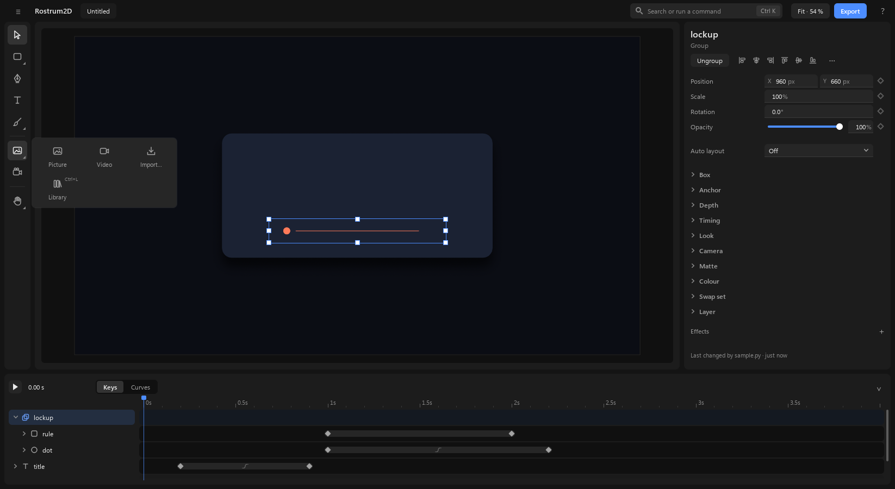

# The screen

A tour of the window, from the top and round the edges. There is one workspace: the picture in the middle, the settings on the right, the timeline along the bottom. There are no pages to switch between.

## 1. The top bar

1. The **≡** button at the far left opens the file menu (see [files.md](files.md)). Next to it are the app's name and the project's name.
2. The line in the middle says what you did last, then "Saved · 3 changes" (click it for History). In a narrow window the count steps back to "Saved" so the message fits; if the message still doesn't fit, point at "Saved" to read it.
3. The undo arrow comes next. It appears only when there is something to undo or redo. **Ctrl+Z** undoes; **Ctrl+Shift+Z** or **Ctrl+Y** redoes.
4. The box that says "Search or run a command" is the **command box**. Press **Ctrl+K**, type a few letters of what you want, and pick it from the list. It lists only what you can do right now, with the shortcut beside each, and it acts on everything you have picked.
5. **Fit · 54 % ▾** shows the zoom and has the zoom choices (part 2). **Export** opens the Export panel (see [exporting.md](exporting.md)). The **?** at the far right opens **Help**, with these guides.
6. Making new things is not up here: it lives in the tool rail beside the canvas (part 2). A file comes in through its **Media** group.
7. When the window is narrow, things give way in a fixed order and never slide under each other: first the line that says what you did last gets shorter, then the project's name, then the search box becomes just its icon.

## 2. The canvas

1. The big rectangle in the middle is your picture, as it will come out. With nothing picked, its size and speed are in the settings panel.
2. The **tool rail** is the column of icons at the left of the canvas. Only icons: point at one for its name and key. A small corner mark means the icon holds a group; click it to open a panel beside the rail, and the icon then shows the tool you used last from that group.

   

   - **Select** (V): picks, moves and resizes.
   - **Shapes** (R for Rectangle, O for Ellipse): nine shapes: Rectangle, Ellipse, Arc, Triangle, Polygon, Star, Line, Arrow and Spiral.
   - **Pen** (P): draws shapes point by point.
   - **Text** (T).
   - **Brush** (B): paints by hand, on the picked thing or as a new drawing (see [drawing.md](drawing.md)).
   - **Media**: Picture, Video, Import… (see [importing.md](importing.md)) and Library (Ctrl+L). A 3D render shows here when Rostrum3D is there.

   

   - **Add a sound**, **Camera** (C) and **Bone** (J) show when they apply: a sound needs a picked layer, the Bone tool needs a rig (see [characters-sound-camera.md](characters-sound-camera.md)).
   - **Hand** (H) and **Zoom** (Z) are at the foot.

   The tool you pick changes what the mouse does and what the right-hand panel shows. **Esc** steps back one level, down to Select.
   - **Drawing a shape:** press R or O (or pick a shape in the Shapes panel), then drag on the picture where it goes. A line or an arrow is dragged from its start to its end. A small label shows its size as you drag. Hold **Shift** for a square or a circle, **Alt** to draw out from the centre. A click without dragging makes a 200 × 200 shape there. The new shape is picked and the tool goes back to Select. It is one step. Its **Shape** setting changes it into another kind afterwards, and each kind shows only its own settings (a star has **Points** and **Inner radius**).
   - **Text:** press T, click where the words go (they grow as you type) or drag a box (they wrap inside it), and type. **Enter** starts a new line; **Esc** or **Ctrl+Enter** ends, and the text stays picked. All the typing is one step, so **Ctrl+Z** takes back the whole text. While you type, a small bar at the top of the canvas has the **font**, **weight**, **size** and **colour**. **Double-click** a text with Move to type in it again.
   - **Zoom and move around:** **Ctrl+wheel** zooms in and out around the pointer; the wheel scrolls (with **Shift**: sideways); hold **Space** and drag, or drag with the middle button, to move the view. **Ctrl+0** fits the whole picture, **Ctrl+1** shows it at 100 %, **F** fits what is picked, **Ctrl+=** and **Ctrl+−** zoom a step. The **Fit · 54 % ▾** control in the top bar shows the zoom and has the same choices. Zooming is only your view: it is never a change and never undone. The picture is always drawn sharp at the size you see it.
3. **Picking.** A click on a thing picks it. It goes to what is painted: the empty part of a drawing, or an empty group, does not catch the click. If the thing is inside a group, the click picks the outermost group (so the whole logo moves); **double-click** goes one level in; **Ctrl+click** picks the piece under the pointer straight away. **Shift+click** adds a thing to what is picked or takes it out. Drag a box on empty canvas to pick everything it touches. **Ctrl+A** picks every layer, and **Esc** lets go of the picking.
4. Drag a picked thing to move it, or drag a small square on its edge to resize it. The box and the picture move together. While you drag, it **snaps** to the edges and centre lines of the picture and of other layers when it comes within a few pixels, and a thin magenta line shows what it caught. Hold **Ctrl** during the drag to place it freely; hold **Shift** to keep it moving straight across or straight up and down. While you drag, the picture is drawn a little smaller so it keeps up; one full-size picture follows when you let go.
5. **Nudge** with the arrow keys: 1 pixel, 10 with **Shift**, or a tenth of a pixel with **Alt**, for every picked layer. Each press is one change.
6. **Copy, cut and paste**: **Ctrl+C** copies the picked layers, **Ctrl+X** cuts them and **Ctrl+V** pastes them, in the same place and in the same project or another one. **Ctrl+D** makes a copy next to the original.
7. With nothing picked, the right-hand panel shows the picture's own settings: **Width**, **Height**, **Frame rate**, **Length** and **Background**.

## 3. Select first, then act

Anything that relates layers to each other starts from what you have picked: you pick the things, then act. The same short list of actions shows up in four places, and only what applies to your picking is ever in it:

1. The **top of the settings panel**: the actions that fit what is picked, as buttons, and only those: **Combine** (two or more shapes: union, subtract, intersect, exclude), **Group** / **Ungroup**, **Mask** (by its shape, brightness or darkness; a picture and a shape put it first), **Align**, **Distribute** (three or more layers), **Stagger…**, **Styles** for text. Each action keeps its place: what works on one layer (Align) comes first, and picking more layers only adds actions after it. **⋯** (more), at the end of the row, holds the less used ones (Clip to a box, Auto layout, Make swap set, Make rig, Match size (not for text or a camera: they have no size of their own), Fill the frame, Copy / Paste style …). When nothing but less used actions fit, there is no row at all: they are on right-click and in **Ctrl+K**.
2. A **right-click** (on the canvas, a layer's name or its row in the timeline) opens the same short menu everywhere: Cut, Copy, Paste, Duplicate, Delete · Group / Ungroup · Bring forward / Send backward · Hide, Lock, Rename.
3. **Ctrl+K**, by name.
4. Shortcuts: **Ctrl+G** group, **Ctrl+Shift+G** ungroup, **Ctrl+D** duplicate, **Ctrl+C** / **Ctrl+X** / **Ctrl+V** copy, cut and paste, **Delete**, **F2** rename, **Ctrl+]** and **Ctrl+[** bring forward and send backward (with **Shift**: to the front, to the back), **Alt+A** / **Alt+D** / **Alt+W** / **Alt+S** align left, right, top, bottom, **Alt+H** / **Alt+V** align centre or middle, **Ctrl+Alt+M** mask, **Ctrl+Alt+U** / **S** / **I** / **X** union, subtract, intersect, exclude, **Shift+A** auto layout, **Ctrl+Shift+H** hide, **Ctrl+Shift+L** lock, **Ctrl+Alt+C** / **Ctrl+Alt+V** copy and paste style. A key does its action only when the action fits what is picked.

**Preview before you choose.** Rest the pointer on **Combine** (union, subtract, intersect, exclude), **Align**, **Distribute** or one of the **Mask** ways for a moment (about a quarter of a second) and the canvas shows what it would make, a little lighter than the real thing. Move off and the canvas goes back. Nothing is recorded: the document and Undo are untouched until you click. If an action can't be shown (or would be refused now), the canvas stays as it is.

The whole list: Group, Ungroup, Clip to a box, Auto layout, Make swap set, Make rig, Mask with top layer (and the other ways a mask can cut), Release mask, Union, Subtract, Intersect, Exclude, Align (left, centre, right, top, middle, bottom), Distribute, Match width, height or size, Copy style and Paste style, Lock, Hide, Duplicate, Delete, the four order moves and Rename. Each is one step, so **Ctrl+Z** takes back the whole thing. Nothing is made empty to be filled afterwards: you do not add an empty group and drag things into it, you pick the things and group them.

## 4. The settings panel

1. The panel on the right shows the settings of what is picked. Its heading is the layer's name, and the line under it says what kind of thing it is. When several things are picked it says how many, and shows what they share: a value that differs says "Mixed", and a change sets it on all of them as one step.
2. A few **essential** settings come first. Under them, only the groups that fit this kind of layer. A group where you changed something from its starting value shows open, so you see what you changed. Every other group is a name in one short line ("Paragraph · Font · Outline · Depth · Timing …"): click a name to open that group, and click its heading to fold it back into the line. A small blue dot by a name means something in that folded group was changed. The groups you open or fold stay that way when you pick another layer.
   The line at the very bottom, **Last changed by …**, sits on its own under a thin line; click it to open History.
3. **Find a setting** (**Ctrl+F**) finds any setting by its name or a word of what it does ("opacity", "angle", "gradient"): pick one from the list and its group opens and it is shown. A word that names an effect you have not added yet, such as "blur", shows a line **Add Blur**.
4. It shows only the settings that apply. Turn something on and the settings that go with it appear; turn it off and they go away. Nothing sits there greyed out.
5. A diamond at the right of a setting is its key mark (see [first-animation.md](first-animation.md)).
6. **Colour fields** are a swatch plus a hex box: type `#rrggbb`, or click the swatch for the picker. A fill's picker has six kinds: no fill, solid, linear, radial and angular gradient, and **Picture** (pick a file, then **Fill**, **Fit**, **Tile** or **Stretch**, and a scale). A shape, text or path can all be filled with a picture.

   

7. With the Brush on, the same panel is headed "Painting" and shows the brush instead (see [drawing.md](drawing.md)).

## 5. The timeline is the layers list

1. Along the bottom: one header row, then a row for each layer. The names on the left are your layers, newest on top; the bar beside each name shows when the layer is on screen, with its keys as diamonds.
2. The header row has, over the layer names, the play button, the time (rest the pointer on it for the frame and the scene's length), the flag button **Add marker** (in a project folder), and **Keys** / **Curves**. Over the layer rows it is the ruler: drag on it to move through time. **Space** plays and stops.
3. A name's small arrow folds or opens what is inside a layer: a group's layers, its keyed settings, its effects and masks.
4. Click a name to pick the layer. **Ctrl+click** adds a layer to what is picked or takes it out, and **Shift+click** picks every layer from the last one you clicked to this one; a picked layer's name turns blue, with a thin blue line at its left, and its bar is drawn brighter with a blue outline. Double-click a name (or press **F2**) to rename it. A long name is cut short in the list; point at it to read it whole. Drag it up or down to change what sits in front, or onto a group to put it inside. A line shows where it will land.
5. At the right of a name sit a **lock** and an **eye**. They show when you point at the row, and stay visible while they are on. A **locked** layer cannot be picked or moved on the canvas, and everything refuses it until you unlock it. A **hidden** layer is not drawn, in the preview or in an export, and its name and bar fade. Click to switch; it is one step.
6. Drag the middle of a bar to move the layer in time, and an end to trim it. When several layers are picked, dragging one picked bar moves all the picked bars together. Drag a diamond to move a key. They snap to the playhead and to markers. Click a diamond to change how that key eases; **Curves** shows the curves.
   - **Picking keys:** click a diamond to pick it, **Ctrl+click** to add another (on any layer) or take it out, **Shift+click** to pick every key between on that row. A diamond on a layer's bar stands for all that layer's keys at that moment. Drag one picked key and all of them move together, as one step. **Delete** removes the picked keys. **Esc** lets go of the keys first, then of the layers.
   - **A** opens the picked layers to show only their animated settings; **A** again folds them.
7. **The timeline has two heights.** The full height shows every layer. The **compact** height shows only the header row and the picked layer's row, to give the picture the room; the name there is a menu of all your layers. Switch with the button at the right end of the ruler, or drag the timeline's top edge. Each tool remembers its own height: Select and Pen the full one, Brush the compact one, so picking a tool gives you the right amount of picture. Beside a tall or square frame the timeline has one height, so the button is not there.

## 6. Markers

1. A marker is a named flag on the ruler for a moment you care about.
2. Click **Add marker** (the flag beside the time) to put one at the playhead.
3. Drag a flag to move it. Double-click it to rename it. Click its **×** to remove it.
4. A layer's bar that you let go of on a marker snaps to it and stays tied to it: when the marker moves, the layer follows. A key snaps to a marker too. Other Rostrum apps can follow the same marker, so a sound can be placed on it.

## 7. Problems

If something in the project is wrong, a button such as **1 problem** appears at the top. Click it for the list. It is not there when everything is fine.

Next: [first-animation.md](first-animation.md), [drawing.md](drawing.md), [files.md](files.md).
