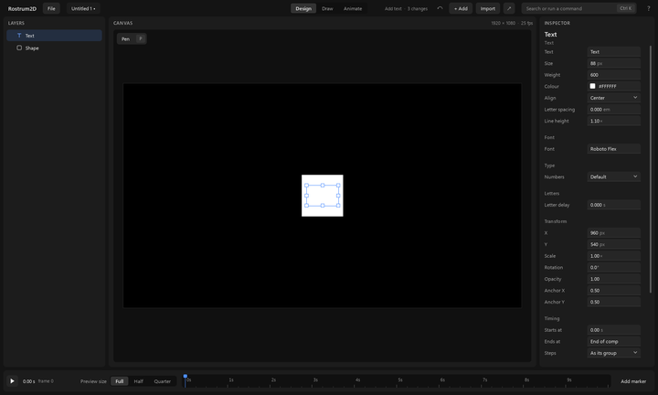

# The screen

For a person using the Rostrum2D app. A tour of the window, from the top and round the edges.

## 1. The top bar

1. **File** at the far left opens the file menu (see [files.md](files.md)). Next to it is the project's name. A small dot after the name means there are changes not saved yet.
2. In the middle are three pages: **Design**, **Draw** and **Animate** (see below).
3. The line to the right of them says what you did last, and how many changes you have made since you opened the project. If it is cut short, hover it to read the whole line.
4. The undo and redo arrows come next. They appear only when there is something to undo or redo. **Ctrl+Z** undoes; **Ctrl+Shift+Z** or **Ctrl+Y** redoes.
5. **+ Add** puts something new in the picture. **Import** brings in a file (see [importing.md](importing.md)). The arrow button opens **Export** (see [exporting.md](exporting.md)).
6. The box that says "Search or run a command" is the **command box**. Press **Ctrl+K**, type a few letters of what you want, and pick it from the list. It lists only what you can do right now, with the shortcut beside each.
7. The **?** at the far right opens **Help**, with these guides.

## 2. The three pages

- **Design**: arrange things. Add shapes, text and pictures, move them, change how they look. The strip along the bottom is a slim time ruler.
- **Draw**: paint by hand on a drawing layer. The panel on the right becomes **Brush**, and the bottom strip shows the drawing's frames (see [drawing.md](drawing.md)).
- **Animate**: change things over time. The bottom becomes the **Timeline**, with a row for each layer (see [first-animation.md](first-animation.md)).

The layers, the picture and the right-hand panel stay on every page.

## 3. Layers

1. The panel on the left lists everything in your picture, newest on top. Each row has a small icon for what it is: text, shape, drawing and so on.
2. Click a row to select it. Double-click to rename it (or press **F2**).
3. Drag a row up or down to change what sits in front. A line shows where it will land.
4. Right-click a row for a menu of what you can do to that layer. Only what applies is listed.
5. **Delete** removes the selected layer. **Ctrl+D** makes a copy.
6. A row with a small arrow can be folded or opened. Click the arrow.

## 4. The canvas

1. The big black rectangle in the middle is your picture. Its size and speed show at the top right of the canvas, for example "1920 × 1080 · 25 fps".
2. Click a thing to select it. Drag it to move it. Drag a small square on its edge to resize it.
3. With nothing selected, the right-hand panel shows the picture's own settings: **Width**, **Height**, **Frame rate**, **Length** and **Background**.

## 5. The inspector

1. The panel on the right shows the settings of what is selected. Its heading is the layer's name, and the line under it says what kind of thing it is.
2. It shows only the settings that apply. Turn something on and the settings that go with it appear. Turn it off and they go away. Nothing sits there greyed out.
3. The most useful settings come first. **More**, at the bottom, opens the less common ones. Click it again to hide them.
4. A diamond at the right of a setting is its key mark (see [first-animation.md](first-animation.md)).

## 6. The timeline and the ruler

1. The ruler counts seconds. Click or drag on it to move the playhead.
2. On **Animate**, **Keys** shows the diamonds. **Curves** shows how each value eases between its keys.
3. Click a diamond to select that key and change how it eases.
4. The play button, the time and **Preview size** (**Full**, **Half**, **Quarter**) sit in the strip too. **Space** plays and stops.

## 7. Markers

1. A marker is a named flag on the ruler for a moment you care about.
2. Click **Add marker** to put one at the playhead.
3. Drag a flag to move it. Double-click it to rename it. Click its **×** to remove it.
4. Other Rostrum apps can follow the same marker, so a sound can be placed on it.

## 8. Problems

If something in the project is wrong, a button such as **1 problem** appears at the top. Click it for the list. It is not there when everything is fine.

Next: [first-animation.md](first-animation.md), [drawing.md](drawing.md), [files.md](files.md).
