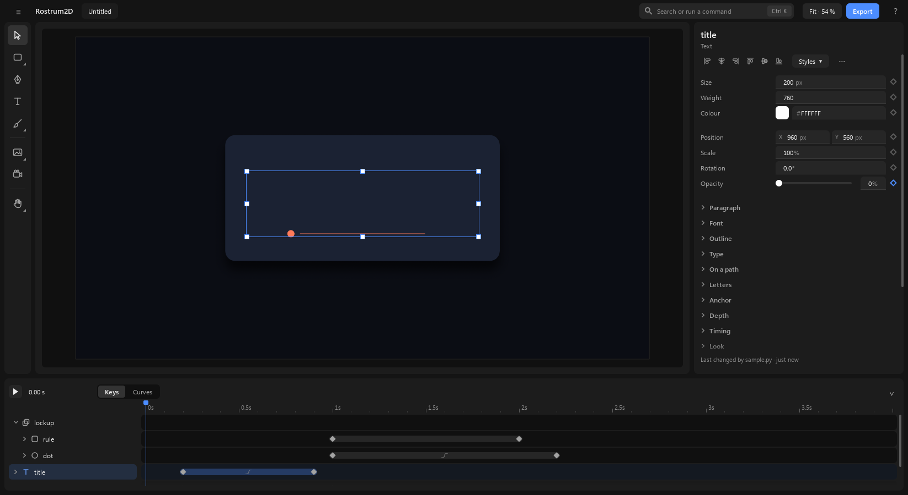
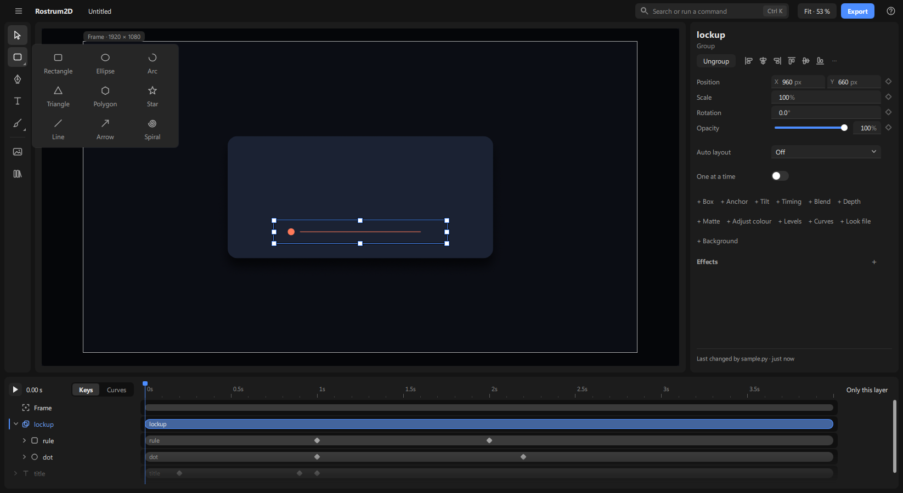
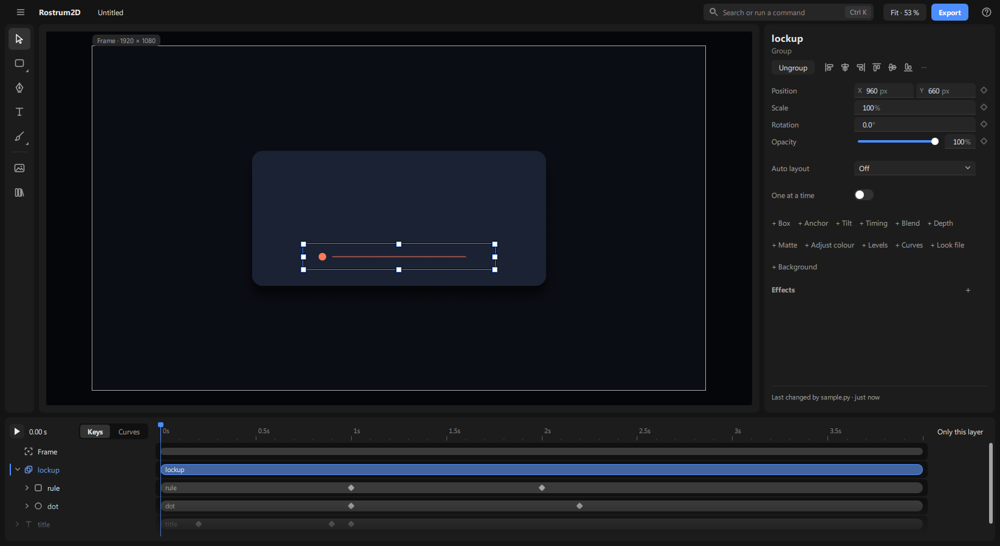
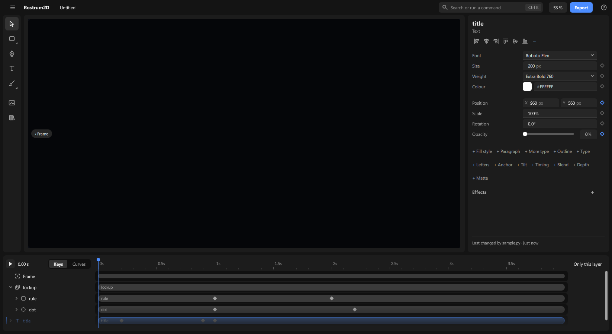
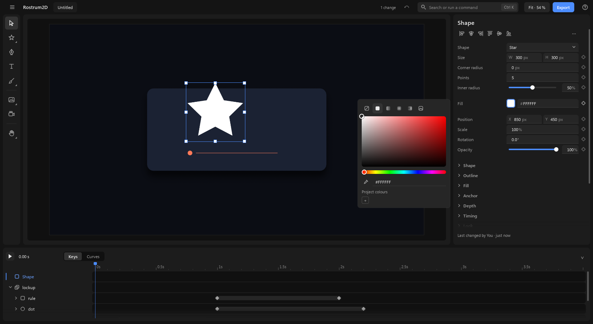

# The screen

A tour of the window, from the top and round the edges. There is one workspace: the picture in the middle, the settings on the right, the timeline along the bottom. There are no pages to switch between.

## 1. The top bar

1. The **≡** button at the far left opens the file menu (see [files.md](files.md)). Next to it are the app's name and the project's name, plain text; click the name to rename the project. After the name, **› Main ▾** is the scene the window shows: click it for the list of scenes (the shown one is ticked; click another to look at it), then what you can do with the scene shown: **New scene**, **Rename scene** (or double-click the name and type; Enter keeps, Esc drops), **Duplicate scene** (a copy with everything in it, right after it), **Move scene earlier** / **later** (only where there is room) and **Delete scene** (only when there is more than one). Ctrl+K finds the same: type a scene's name to show it, or "new scene". A new scene is numbered (Scene 2, Scene 3 …), starts with the size, rate, length and background of the one you were in, and is shown at once; **Ctrl+Z** takes it away again and shows the scene you were in. Delete asks nothing: the top bar says "Deleted Intro — Ctrl+Z brings it back". To move layers between scenes, copy them (**Ctrl+C**), show the other scene and paste (**Ctrl+V**). Agents make scenes with `comp.add` (or `comp(...)` in a script), copy one with `comp.duplicate`, reorder with `comp.move`, rename with `item.rename` and delete with `comp.remove`; they need no switching: every call names the scene it works in.
2. The line in the middle says what you did last, then "Saved · 3 changes" (click it for History). In a narrow window the count steps back to "Saved" so the message fits; if the message still doesn't fit, point at "Saved" to read it.
3. The undo arrow comes next. It appears only when there is something to undo; the redo arrow appears to its left, so the undo arrow never moves (click it again and again to go back step by step). **Ctrl+Z** undoes; **Ctrl+Shift+Z** or **Ctrl+Y** redoes.
4. The box that says "Search or run a command" is the **command box**. Press **Ctrl+K**, type a few letters of what you want, and pick it from the list (**Ctrl+K** again or **Esc** closes it). It lists only what you can do right now, with the shortcut beside each, and it acts on everything you have picked. It also lists the view's steps (**Fit the frame**, **Fit everything**, **Zoom 25 – 400 %**, **Zoom in**, **Zoom out**, **Zoom to selection**, **Look through the frame**, snapping), so "fit" or "zoom" finds them. Every key on the Keys sheet (**Ctrl+/**) is in it too (**Undo**, **History**, **Play / stop**, **Rectangle**, **Add a marker at the playhead** ...), and so is every entry of the ≡ and Help menus (**Open recent**, **Start screen**, **About and licences** ...). Every setting of what is picked is in it too: **Edit Opacity** takes you to its box with the cursor in it; a setting group that is off is offered as the panel names it (**Add Motion blur** turns motion blur on and puts the cursor in its amount). Words that match nothing stay in the box, so you can fix them. A word that is a thing's name (or starts it) finds that thing first, and when some command's name says your words, commands that only have them in their description are not listed; a word that only appears in a description never adds a scene or a layer. Each thing is listed once: **Lock**, **Hide** and **Fill the frame** are there as the actions, not again as switches, and keys are picked on the timeline, not offered as "Select" rows. Something that doesn't fit what is picked is not listed at all (type its name and the box says why instead; press its key and the top bar says why). A locked layer (or a locked Frame) is offered only what works on it: **Unlock** and the lock switch.
5. **Fit · 53 % ▾** shows the zoom and has the zoom choices (part 2). **Export** opens the Export panel (see [exporting.md](exporting.md)). The **?** at the far right opens **Help**, with these guides.
6. Making new things is not up here: it lives in the tool rail beside the canvas (part 2). A file comes in through **Add from a file…**.
7. When the window is narrow, things give way in a fixed order and never slide under each other: first the line that says what you did last gets shorter, then the project's name, then the search box becomes just its icon.

## 2. The canvas

1. The big rectangle in the middle is your picture, as it will come out. With nothing picked, its size and speed are in the settings panel.
2. The **tool rail** is the column of icons at the left of the canvas. Only icons: point at one for its name and key. A small corner mark means the icon holds a group; click it to open a panel beside the rail, and the icon then shows the tool you used last from that group.

   

   - **Select** (V): picks, moves and resizes.
   - **Shapes** (R for Rectangle, O for Ellipse): a click uses the shape shown on the icon; hold the button down, or click its corner mark, for the list of all nine: Rectangle, Ellipse, Arc, Triangle, Polygon, Star, Line, Arrow and Spiral.
   - **Pen** (P): draws shapes point by point.
   - **Text** (T).
   - **Brush** (B): paints by hand, on the picked thing or as a new drawing (see [drawing.md](drawing.md)).
   - **Add from a file…** (Ctrl+I, the picture icon) opens the file picker and brings the file in at once (see [importing.md](importing.md)). Once a Rostrum3D item of the project has a finished render, the button opens a short list with each such item by name: a click places that render (see [3d-renders-in-2d.md](3d-renders-in-2d.md)). **Library** (Ctrl+L, the books icon) is the next button.

   

   - **Add a sound** and **Bone** (J) show when they apply: a sound needs a picked layer, the Bone tool needs a rig (J with none picked says so in the top bar; see [characters-sound-styles.md](characters-sound-styles.md)). There is no camera tool: you move the frame like a layer (below).
   - **Hand** (H) and **Zoom** (Z) are keys only: they are not in the rail. Space-drag and the middle button also move the view, and **Fit · 53 %** has the zoom.

   The tool you pick changes what the mouse does and what the right-hand panel shows. **Esc** steps back one level, down to Select. While you still hold the mouse in a drag (moving, resizing or turning a layer, a handle, the anchor, a path point, a key, a bar, a curve), **Esc** puts everything back as it was before the press, with nothing to undo; let go afterwards.
   - **Drawing a shape:** press R or O (or pick a shape in the Shapes panel), then drag on the picture where it goes. A line or an arrow is dragged from its start to its end. A small label shows its size as you drag. Hold **Shift** for a square or a circle, **Alt** to draw out from the centre. A click without dragging makes a 200 × 200 shape there. A drawn shape (and a text's click point) lands on whole pixels at any zoom, so its X, Y, W and H read as whole numbers. The new shape starts light grey (never the blue of the selection, so a picked thing always shows on it) and is picked, and the tool goes back to Select. Every picked thing is outlined in the accent colour with a thin dark edge on both sides, so the box and its handles show on any colour, blue included. It is one step. Its **Shape** setting changes it into another kind afterwards, and each kind shows only its own settings (a star has **Points** and **Inner radius**).
   - **Text:** press T, click where the words go or drag a box (they wrap inside it), and type. The click is the middle of the first line, and the words grow both ways from it as you type, the same place a script's text at that X, Y takes. **Paragraph › Align** keeps X and re-flows the words around it: Left makes X the left edge, Right the right edge, Center the middle (so typing X 960 and Align Center centres a title in a 1920 frame). **Enter** starts a new line; **Esc** or **Ctrl+Enter** ends, as does a click anywhere outside the text (the settings panel, the timeline, the picture), and the text stays picked. All the typing is one step, so **Ctrl+Z** takes back the whole text. From the first letter the settings panel shows the new text's **font**, **size**, **weight** and **colour**; nothing pops up over the canvas. **Double-click** a text with Move to type in it again (the caret lands at the end of the words; **Ctrl+A** selects them all to replace them), or pick it and press **Enter**: every word is picked, so what you type replaces them.
   - **Zoom and move around:** **Ctrl+wheel** zooms in and out around the pointer; the wheel scrolls (with **Shift**: sideways); hold **Space** and drag, or drag with the middle button, to move the view. **Ctrl+0** fits the frame (the box that becomes your video), centred in the part of the canvas you can see when the Library lies over its left side, **Shift+1** fits everything (every layer, and everywhere the frame travels), **Ctrl+1** shows the picture at 100 %, **F** fits what is picked, **Ctrl+=** (or **Ctrl++**) and **Ctrl+−** zoom a step. The **Fit · 53 % ▾** control in the top bar shows the zoom and has the same choices: **Fit the frame**, **Fit everything**, **25 %** to **400 %**, **Zoom to selection** (only with something picked), **Look through the frame**, **Turn snapping on / off**, **Show the frame's path**, and, for a large scene, **Preview while playing** (Full, Half, Quarter) and **Motion blur while playing**. The keys list (**Ctrl+/**) shows each one's key; **Ctrl+0** is Fit the frame, **Shift+1** Fit everything, **F** or **Shift+2** Zoom to selection. Zooming is only your view: it is never a change and never undone. The picture is always drawn sharp at the size you see it.
   - **The frame and the world around it:** the canvas is the whole world, not just the video. The frame is the part that is exported. It has a thin light outline, and everything outside it is dimmed, so you can see what is in the video and what waits just off its edge. A small tab over the outline's top-left corner names it with its size (**Frame · 1920 × 1080**), or with its zoom once the frame is zoomed (**Frame · 1.4×**). If the frame is turned, the outline and tab turn with it. When you scroll or zoom the frame completely out of view, a small **‹ Frame** chip appears on the edge it lies beyond (the arrow points the way); click it to bring the frame back into view.  The chip never moves the view on its own. Things outside the frame are a normal place to work: lay out the next shot beside the frame, and nothing calls them a problem. **Shift+C** (or **Look through the frame** in the **Fit · 53 % ▾** menu) looks through the frame: the canvas fits the frame and shows exactly the video, nothing outside it, with a small **Through the frame ×** label at its bottom-left (click the × or press Shift+C again to go back). You can still pick, drag, type and paint there; the frame has no handles while you look through it, and scrubbing follows its move. While the project plays, the canvas always looks through the frame; when it stops, your view comes back as you left it (where you had scrolled, at the same zoom). Looking through is only your view, never a change.

     
   - **Picking and moving the frame:** press **C**, click the frame's name tab, or click the **Frame** row at the top of the timeline. The outline and tab turn blue and four small squares appear at its corners. Clicking the outline itself never picks the frame, so things at its edge stay easy to pick. Then:
     - **Drag anywhere inside the frame** (even over a layer) to move it. A click without a drag still picks the thing under the pointer. It snaps its edges and centre to the layers' edges and centres, and its centre to where it started (**Ctrl** places it freely, **Shift** keeps it straight).
     - **Drag a corner square** to zoom it: outward makes the box bigger, so it shows more (the zoom goes down); inward zooms in. The tab shows the zoom as you drag ("Frame · 0.80×"). It keeps the picture's shape and grows about its centre (**Alt**: about the opposite corner).
     - **Drag just outside a corner** to turn it (**Shift** snaps to 15°; it settles at 0° when close). The tab and squares turn with it.
     - Like any layer: when the frame has no keys, the move is for the whole piece (the top bar says "Moved the frame (whole piece)"); once it has keys, the drag sets a key at the playhead. **K** keys its Position, Zoom and Rotation at the playhead. Each drag is one undo step. A locked frame refuses, and says it is locked.
     - **Its path:** with the frame picked, a line shows where its centre travels, with a dot per frame, a square at each key (drag it to change the frame's place at that key, drag its handles to bend the move) and a faint outline of the frame at each key, so you see each shot. A **cut** (a key with the Hold ease, then the next key) shows as a dashed line with no dots: nothing travels there. With something else picked the frame's path stays faint; **Show the frame's path** in the **Fit · 53 % ▾** menu (on at first) turns that off. It is only your view, never a change.
     - **Its settings** (right-hand panel, headed **Frame**, "What the export shows · 1920 × 1080"): **Position** (the world point at its centre; its reset puts the frame back where it started), **Zoom** (×) and **Rotation** (°), each with its diamond, and **Ride a path** when the scene has a path to ride. The size is the scene's, in Scene settings. Above them, the actions, only the ones that work now: **Frame the view** (the frame fits what your canvas shows, keyed at the playhead); **Cut here** (a jump at the playhead, then move the frame to the next shot) appears only once the playhead is after 0 s, because a cut at the very start has nothing before it; **More** appears only when it holds something, such as **Frame home** (only while the frame is away from home). **Lock** is the padlock on the Frame row (it is also in the right-click menu), not in **More**. Right-click (its row or the canvas) offers the same; **Ctrl+K** also has **Cut to the view**. With layers picked, **More** has **Move the frame to these** and **Cut to these**. A locked frame offers only **Unlock**. How to make a push or a cut with them: [the frame guide](frame-parallax-motion-blur.md).
3. **Picking.** A click on a thing picks it. It goes to what is painted: only a painted pixel of a drawing (or a few pixels beside a stroke) catches the click, not the empty canvas between and around its strokes, and an empty group catches nothing. If the thing is inside a group, the click picks the outermost group (so the whole logo moves); **double-click** goes one level in; **Ctrl+click** picks the piece under the pointer straight away. **Alt+click** picks the layer behind the one you picked; click again to go further back. Or right-click › **Select layer** for a list of everything under the pointer (the row is there only where layers overlap; rest the pointer on a name to see which layer it is, click it to pick it). **Shift+click** adds a thing to what is picked or takes it out. Drag a box on empty canvas to pick everything it touches. **Tab** and **Shift+Tab** pick the next and previous layer; **Enter** goes into a group, **Shift+Enter** comes back out. **Ctrl+A** picks every layer at the level you are in (inside a group, that group's layers), and **Esc** lets go of the picking.
4. Drag a picked thing to move it, or drag a small square on its edge to resize it. The box and the picture move together. While you drag, it **snaps** to the edges and centre lines of the frame (where it is at the playhead; a frame turned off the square gives only its centre) and of other layers when it comes within a few pixels, and a thin magenta line shows what it caught. Moving a layer between others also snaps it to **equal gaps**: the matching gaps show with their size. When an edge lines up with a neighbour, the gap to it is written on the line. Hold **Ctrl** during the drag to place it freely; hold **Shift** to keep it moving straight across or straight up and down. A side the pointer has hardly left (under the snap distance) stays where it is, so a drag straight down never leans sideways to catch a line; and a drag that catches nothing lands on whole pixels (finer when zoomed in), so copies step an exact number apart. Drag a square past the opposite side to flip the layer (or the group, or everything picked). **Shift+H** flips across and **Shift+V** flips down. A flip is Stretch below 0 %, so it can be animated: key Stretch X at 100 % and later at −100 % for a card flip. While you drag, the picture is drawn a little smaller so it keeps up; one full-size picture follows when you let go.
   - **A small thing:** when a side of the box is under about 32 screen pixels (a dot at Fit), its squares sit just outside the box on that side instead of on its corners, so they never cover the thing. Drag or **Alt+drag** from the middle of the dot to move it or copy it; drag a square to resize it.
   - **A shape drawn with the Pen:** picking it shows the same box, so it resizes and turns like any layer. **Double-click** it (or press **Enter**) to edit its points instead: square points are corners, round ones are curves; click a point to show its handles and drag the point or a handle (**Alt** moves one handle alone). Each drag is one undo step, and the box then fits the reshaped path. **Esc** goes back to the box.
   - **A group picked:** drag a square and everything in the group grows or shrinks with it, like a Figma frame's contents: a corner scales it as a whole, a side square stretches it one way (the group's Scale and Stretch change; the layers inside keep their own settings). **Shift** keeps the proportion, **Alt** resizes from the centre; one undo step.
   - **A line or an arrow picked:** two squares sit on its two end points and nothing else. Drag an end to move that end: the length and the turn follow and the other end stays put (**Alt** keeps the middle still, **Shift** snaps the turn to 15° steps). Press anywhere else on the line to move the whole line. There are no side squares and no turn zones; an end does the turning.
   - **Moving the anchor:** open **+ Anchor** in the settings panel and a small ring appears on the picture at the anchor, the point the layer turns and scales about. Drag the ring to move the point (it catches the edges and the middle; hold **Ctrl** to place it freely): the layer stays exactly where it is and its Position follows, so only the turn and scale centre moves. One undo step. Fold the group and the ring goes. A square under the ring is reached by folding the group first. Typing in the Anchor X / Y fields still works.
   - **Several layers picked:** one box is drawn round them all, with the same squares and turn zones as a single layer. Drag a square to resize them all together (the opposite side stays put; **Shift** keeps the proportion, **Alt** resizes from the centre). Drag just outside a corner to turn them all about the middle of the box (**Shift** snaps to 15°). Each drag is one undo step. Layers placed by an auto layout, or whose Position or size is driven by an expression, can't be resized or turned this way; pick one alone.
5. **Nudge** with the arrow keys (while the Select tool is on; **Ctrl+A** selects all layers under it too): 1 pixel, 10 with **Shift**, or a tenth of a pixel with **Alt**, for every picked layer. Each press is one change.
6. **Copy, cut and paste**: **Ctrl+C** copies the picked layers, **Ctrl+X** cuts them and **Ctrl+V** pastes them, into the same project, another scene or another project. A pasted copy never lands exactly on top of what it was copied from: where a layer already sits in that place the copy steps 24 px right and down, and each further copy steps once more. Pasted into a scene where nothing sits there, it keeps its place. **Ctrl+D** copies in place: the copy lands just above the original in the stack, on top of it, and is picked, so a step you type on it (X "+64") is the whole step from the original. **Alt+drag** a layer on the picture copies it and moves the copy in one go: the original stays (one step to undo). **Alt+Shift+drag** does the same along a straight line; an Alt+Shift click without a drag leaves what is picked alone. Then **Ctrl+D** repeats your step: the step is from the original to where the copy sits now, however you made the copy (Ctrl+D or Alt+drag) and however you moved, turned or scaled it after. So for a row, Alt+drag a copy 300 px right (or Ctrl+D and drag the copy there), then press **Ctrl+D** as often as you need: each new copy lands 300 px on. For a grid, pick the whole row and do the same downwards; for a ring, turn the copy. The top bar names the step ("Duplicated · 300 px across"). One **Ctrl+Z** takes a paste or a copy away. Agents: `layer.duplicate` with `by_x: 0` copies in place as Ctrl+D does, with `by_x`, `by_y`, `by_turn`, `by_scale` it takes that step, and with none of them it follows the paste rule (24 px on where the place is taken), as `layer.paste` does.
7. **The motion path.** When the picked thing moves (its **Position** has two or more keys), a thin line shows where it travels, with a dot for each frame: dots close together mean slow, far apart mean fast. Each key is a small square (filled when the key is picked). Click a square to pick that key; drag it to move the thing's position at that key (it snaps like a thing dragged on the picture; hold **Ctrl** or **Alt** to place it freely). A key timed on a marker shows at the marker's time. A picked key, or one whose path you have bent, shows two handles; drag a round end to bend the path, and the other handle follows so the curve stays smooth (hold **Alt** to move one handle alone). Each drag is one change. A thing riding a path shows no motion path (the path it rides is shown). The motion path hides while the project plays. The selection box and the path sit where the layer is drawn on the canvas, which shows the world: a far layer moves less than the frame, and a drag moves it under the pointer anyway.
8. A project opens with nothing picked. Then the right-hand panel shows the scene's own settings, headed **Scene**: **Format** (a list of sizes, such as Wide 16:9), **Size** (W and H), **Frame rate**, **Length** and **Background**. A click on empty canvas, or **Esc**, comes back to them. The frame is picked only when you ask for it (**C**, its tab or its **Frame** row), so a drag on the empty canvas never moves the shot by accident.

## 3. Select first, then act

Anything that relates layers to each other starts from what you have picked: you pick the things, then act. The same short list of actions shows up in four places, and only what applies to your picking is ever in it:

1. The **top of the settings panel**: the actions that fit what is picked, as buttons, and only those: **Combine** (two or more shapes: union, subtract, intersect, exclude), **Group** (two or more layers; with one layer it is in **More**, right-click and Ctrl+K) / **Ungroup** (a group picked alone shows only **Ungroup**), **Mask** (by its shape, brightness or darkness; the top layer of the picked ones is the cutter: resting on Mask shows the picture it would make and names the cutter in the top bar, and the top bar names it again once it is made; a picture and a shape put it first), **Align**, **Distribute** (three or more layers), **Stagger…**, **Styles** for text; with the frame picked, **Frame the view** and **Cut here** (part 2). Each action keeps its place: what works on one layer (Align) comes first, and picking more layers only adds actions after it. **More**, at the end of the row, holds the less used ones (Crop to a box, Auto layout, Make swap set, Make rig (two or more layers, or a group), Match width, height or size (two or more shapes, pictures or groups in one place; not text, which has no size of its own), Fit to frame (Fill the frame, Fit inside the frame; for a picture or clip it is on the row itself), Move the frame to these and Cut to these (the frame moves to show the picked layers, or jumps to them), Copy / Paste style …). With one layer picked, the align buttons align it to the frame (their names say so). On a layer whose position is animated, Align (and Distribute, Match size, Fit to frame) keys the setting it changes at the playhead, and the top bar says so: "Align centre to the frame · keyed X at 3.00 s". **Styles** appears once the scene has a text style. When nothing but less used actions fit, there is no row at all: they are on right-click and in **Ctrl+K**. **Alt+Shift+H** / **Alt+Shift+V** give even gaps across / down. Once the gaps are even, the panel shows **Gap**: type a new one to re-space them.
2. A **right-click** (on the canvas, a layer's name or its row in the timeline) opens the same short menu everywhere: Cut, Copy, Paste, Duplicate, Delete · Group / Ungroup · Bring to front / Bring forward / Send backward / Send to back (the moves that would change something), Flip across, Flip down · Hide, Lock, Rename. A right-click on empty canvas offers Paste (when something is copied) and Select all.
3. **Ctrl+K**, by name.
4. Shortcuts: **Ctrl+G** groups whatever is picked, even one layer (to give it a parent you can animate on its own; the group's box, and so its turning point, fits the layers as they are at the playhead: group a card that scales in at a moment it is fully in), **Ctrl+Shift+G** ungroup, **Ctrl+D** duplicate, **Ctrl+C** / **Ctrl+X** / **Ctrl+V** copy, cut and paste, **Delete**, **F2** rename (Enter keeps the name, Esc drops it, **Ctrl+Z** with nothing typed closes the box and undoes the last change), **Ctrl+]** and **Ctrl+[** bring forward and send backward (with **Shift**: to the front, to the back), **Alt+A** / **Alt+D** / **Alt+W** / **Alt+S** align left, right, top, bottom, **Alt+H** / **Alt+V** align centre or middle, **Shift+H** / **Shift+V** flip across or down, **Ctrl+Alt+M** mask, **Ctrl+Alt+U** / **S** / **I** / **X** union, subtract, intersect, exclude, **Shift+A** auto layout, **Ctrl+Shift+H** hide, **Ctrl+Shift+L** lock, **Ctrl+Alt+C** / **Ctrl+Alt+V** copy and paste style. A key does its action only when the action fits what is picked.

**Preview before you choose.** Rest the pointer on **Combine** (union, subtract, intersect, exclude), **Align**, **Distribute** or one of the **Mask** ways for a moment (about a quarter of a second) and the canvas shows what it would make, a little lighter than the real thing. Move off and the canvas goes back. Nothing is recorded: the document and Undo are untouched until you click. If an action can't be shown (or would be refused now), the canvas stays as it is.

The whole list: Group, Ungroup, Crop to a box, Auto layout, Make swap set, Make rig, Mask with top layer (and the other ways a mask can cut), Release mask, Union, Subtract, Intersect, Exclude, Align (left, centre, right, top, middle, bottom), Distribute, Match width, height or size, Copy style and Paste style, Lock, Hide, Duplicate, Delete, the four order moves and Rename. Each is one step, so **Ctrl+Z** takes back the whole thing. Nothing is made empty to be filled afterwards: you do not add an empty group and drag things into it, you pick the things and group them.

## 4. The settings panel

1. The panel on the right shows the settings of what is picked. Its heading is the layer's name (a text you haven't renamed is called by its words), and the line under it says what kind of thing it is. When several things are picked it says how many, and shows what they share: a value that differs says "Mixed", and a change sets it on all of them as one step. X and Y are the exception: a number typed there moves them together, so the leftmost (topmost) one lands on it and the others keep their spacing. Type **+20** (or **-20**, ***2**) to change each one's own value instead.
   When the things picked are of different kinds (say a text and two shapes), a **Show only** block comes first: one line per kind ("Text", "Shape" …). Click a line to narrow the picking to that kind, and the panel then shows that kind's full settings. The panel changes in one step when you pick: the old settings stay where they are until the new ones replace them whole.
   Any number box takes a sum: `1920/3`, `(100+20)*2`. Start with `+`, `*` or `/` to work from what is there: `+20` moves it 20 further, `*2` doubles it. With several layers picked, `+20` adds 20 to each one's own value. Start with `=` for an expression that keeps working (see [expressions.md](expressions.md)).
2. A few **essential** settings come first. Under them, only the groups that fit this kind of layer. A group where you changed something from its starting value shows open, so you see what you changed. Every other group is a name in one line that wraps, every name in sight ("+ Paragraph · + Width and slant · + Outline · + Timing …"): click a name to open that group, and click its heading to fold it back into the line. A group that is something you add, like **+ Outline**, a group's **+ Background**, the scene's **+ Motion blur** (it starts at 180°, the film look) or a picture's **+ Adjust colour**, **+ Levels** and **+ Curves**, is added by that one click (it is on and its settings show); the **−** at the right of its heading removes it again. Only groups that mean something for this layer are named: colour effects only where there is a picture to grade, **Depth** only for the scene's own layers (changing it keeps the layer where it shows at the playhead; a pinned layer shows only **Sticks to the shot**); lock and hide live on the layer's timeline row. A text, like every layer, has a **Ride** group (**Rides path**, **Rides at**, **Along path**, **Turn with path**) to sit on a path layer; the letters following a path (**Follows path**) are in its **On a path** group. A small blue dot by a name means something in that folded group was changed. The groups you open or fold stay that way when you pick another layer.
   **Tab** moves from one field to the next in the order they lie (Position X, then Y, then Scale …) and selects what is in it, so you can type X, Tab, Y; **Shift+Tab** goes back.
   The line at the very bottom, **Last changed by …**, shows only when someone else (an agent) changed the picked layer last; it sits on its own under a thin line, and a click opens History.
3. **Find a setting** (**Ctrl+F**) finds any setting by its name or a word of what it does ("opacity", "angle", "gradient"): pick one from the list and its group opens and it is shown. A word that names an effect you have not added yet, such as "blur", shows a line **Add Blur**.
4. It shows only the settings that apply. Turn something on and the settings that go with it appear; turn it off and they go away. Nothing sits there greyed out.
5. A diamond at the right of a setting is its key mark (see [first-animation.md](first-animation.md)). **Position** and **Size** have one diamond for both values: it keys X and Y (W and H) together, as one step. The other two-value settings (**Tilt**, **Anchor**, **Stretch**) also have one diamond, but they keep keys only on the value that changes: key Tilt, then type Tilt Y −90 at another moment, and the Tilt X keys that only held 0 go (X keeps its value). Once one of the two is animated, the diamond keys only that one; typing the other one later keys it from there on, holding its old value at the earlier keys.
6. **Colour fields** are a swatch plus a hex box: type `#rrggbb`, or click the swatch for the picker. A fill's picker has seven kinds (a row of small buttons, each named on hover; the chosen kind's name shows under them): no fill, solid, linear, radial and angular gradient, **Picture** (pick a file) and, on a shape or path, **Painted** (a painting of the scene that many layers can share: [drawing.md](drawing.md) part 9). Under a picture or painting: **Fill**, **Fit**, **Tile** or **Stretch**, then only the rows that apply: **Scale** and **Offset** (not with Stretch), **Rotation** and **Drift** (Tile only), **Colour under it** ("no colour +" until you set one; right-click › Reset takes it away), **Blend** (once there is a colour under it) and **Opacity**. Their diamonds key them like any setting. A painted fill ends with **Paint it** (**B**) and how many layers use the painting: it closes the picker and turns the brush on, painting the painting right on this layer ([drawing.md](drawing.md) part 9). The Fill row then shows the picture, or the painting's picture and name. On a Line, Arrow or Spiral (all line, no inside) the row is called **Stroke**; on a text it is **Colour**.

   

7. With the Brush on, the same panel is headed "Painting" and shows the brush instead (see [drawing.md](drawing.md)).

## 5. The timeline is the layers list

1. Along the bottom: one header row, then a row for each layer. The first row is always the **Frame** (the box that is exported); under it are your layers, newest on top. Every layer has a bar beside its name for the time it shows, from its start to its end, with its name written in it and its keys as diamonds on it; a new layer's bar runs the whole length (keys less than a diamond's width apart share one diamond with a second peeking out behind it; zoom in and they come apart).
   - **The Frame row** has a frame icon and a **lock**, but no eye (the export can't be hidden). It can't be renamed, moved in the list or deleted, and nothing that doesn't apply to it is offered. Its bar is the whole scene and can't be slid or trimmed. Its keys are diamonds like any layer's. A **cut** shows as a short orange tick through the ruler and on the row, so the shot changes read at a glance.
2. The header row has, over the layer names, the play button, the time (rest the pointer on it for the frame and the scene's length), the flag button **Add marker** (in a project folder), and **Keys** / **Curves** (while the picked layer has something animated). Nothing else is written there: no hints. Click the time to type one: `2.5` (seconds), `60f` (frames), `1:12` (minutes:seconds), `+12f` (12 frames on), `-0.5` (half a second back) or a marker's name; Enter (or a click elsewhere) goes there, Esc leaves it, and a time past the end of the scene is refused with the scene's length. **Alt+Shift+J** does the same from the keyboard. Over the layer rows it is the ruler: drag on it to move through time. **Space** plays and stops.
3. A name's small arrow folds or opens what is inside a layer: a group's layers, its keyed settings, its effects and masks.
4. Click a name to pick the layer. **Ctrl+click** adds a layer to what is picked or takes it out, and **Shift+click** picks every layer from the last one you clicked to this one; a picked layer's name turns blue, with a thin blue line at its left, and its bar is drawn brighter with a blue outline. Double-click a name (or press **F2**) to rename it. A long name is cut short in the list; point at it to read it whole. Drag it up or down to change what sits in front, or onto a group to put it inside. A line shows where it will land.
5. At the right of a layer's name sit a **lock** and an **eye**. They show when you point at the row, and stay visible while they are on. A **locked** layer cannot be picked or moved on the canvas, and everything refuses it until you unlock it. A **hidden** layer is not drawn, in the preview or in an export, and its name and bar fade. Click to switch; it is one step. Press an eye or a lock and drag down (or up) the list to set many at once: every row the pointer passes takes the first row's new state, shown as you drag, and it is one step (one **Ctrl+Z** puts them all back). A hidden layer is left as it is when it is locked, or inside a locked group. **Alt+click** an eye to see only that layer (the others at its level are hidden); Alt+click it again to bring back just the ones it hid. A layer **pinned to the frame** (it moves with the shot: a title, a logo bug) has a small pin after its name; pin or unpin it with **Sticks to the shot** in its **Depth** settings, or **More › Stick to the shot** / **Unstick from the shot**. It stays where it shows at the playhead, and in the world view it rides inside the frame's outline ([the frame guide](frame-parallax-motion-blur.md)).
6. Drag the middle of a layer's bar to move the layer in time, and an end (the pointer becomes a two-way arrow) to trim it (with a key right at that end, the handle sits just outside its diamond; a key at 0 s leaves the start no handle: drag the bar). Let go on a marker and that end is tied to it. When several layers are picked, dragging one picked bar moves all the picked bars together. Drag a diamond to move a key; dragged past the layer's end, the end moves along with it. Bars and keys snap to the playhead, markers, other keys and beats, and a small label by the pointer says what they caught ("+15 f · beat 3", "drop"). Click a diamond to change how that key eases (right-click it for the ease list); drag a box over diamonds to pick several, starting on an empty part of a row or in the gap between two rows (a drag that starts on a bar moves the layer; past the timeline's top or bottom the rows scroll with it); **Ctrl+Alt+A** picks every key of the picked layers; **Curves** shows the curves.
   - **Picking keys:** click a diamond to pick it, **Ctrl+click** to add another (on any layer) or take it out, **Shift+click** to pick every key between on that row. A diamond on a layer's bar stands for all that layer's keys at that moment. Drag one picked key and all of them move together, as one step. **← / →** move picked keys a frame (**Shift** ten); **↑ / ↓** leave them alone, and **Alt** with an arrow still nudges the layer. **Delete** removes the picked keys, **Ctrl+D** puts copies of them right after the last one (press again to repeat), and **Ctrl+C** copies them: pick other layers, move the playhead and press **Ctrl+V** to paste them there. **Ctrl+Shift+V** pastes keys at the times they were copied from. Clicking a layer (on the picture, its name or its bar), **Ctrl+A** or **Esc** lets go of the keys, so the keys then act on the layers again. **Esc** lets go of the keys first, then of the layers.
   - **A** opens the picked layers to show only their animated settings; **A** again folds them.
7. **The timeline has two heights.** The full height shows every layer. The **compact** height shows only the header row and the picked layer's row, to give the picture the room (at **Fit** the frame fits the new room at once; zoomed in, the picture stays exactly where it is and the extra room opens below it); the name there is a menu of all your layers. Switch with the button at the right end of the ruler (**Only this layer** / **Show all layers**; it is there while a layer, not the Frame, is picked), or drag the timeline's top edge. Each tool remembers its own height, and every tool starts at the full one (opening the Brush never resizes the canvas); fold it when you want more room to paint. A tall or square frame (a phone-shaped 1080 × 1920 or 1080 × 1350 picture) keeps the timeline across the bottom, as After Effects does, as long as the picture stays a good size; only when that would shrink the picture too much does the timeline move up beside it, with one height and no button.

## 6. Markers

1. A marker is a named flag on the ruler for a moment you care about.
2. Click **Add marker** (the flag beside the time) to put one at the playhead.
3. Drag a flag to move it. Double-click it to rename it. Point at it and its **×** appears: click it to remove the marker. Right-click it for a short menu: **Rename marker**, **Move to playhead**, **Colour**, **Delete marker**.
4. A layer's bar that you let go of on a marker snaps to it and stays tied to it: when the marker moves, the layer follows. A key snaps to a marker too. Other Rostrum apps can follow the same marker, so a sound can be placed on it.

## 7. Problems

If something in the project is wrong, a button such as **1 problem** appears at the top. Click it for the list, written in plain words ("Frame's zoom: 3 keys that all hold 1"). The frame's own tools (Cut here, Move the frame to these, Frame home) only key what changes, so they never cause one. It is not there when everything is fine.

Next: [first-animation.md](first-animation.md), [drawing.md](drawing.md), [files.md](files.md).
