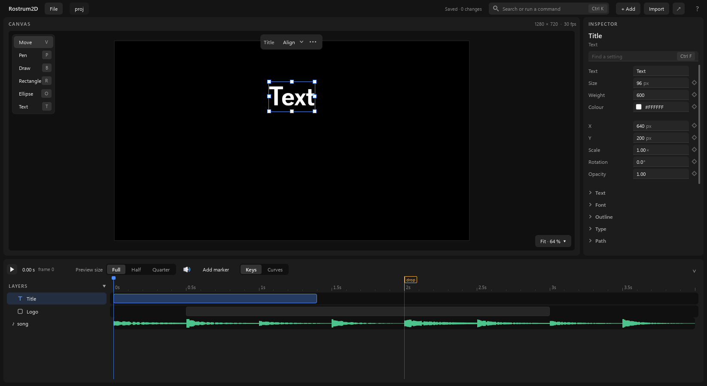
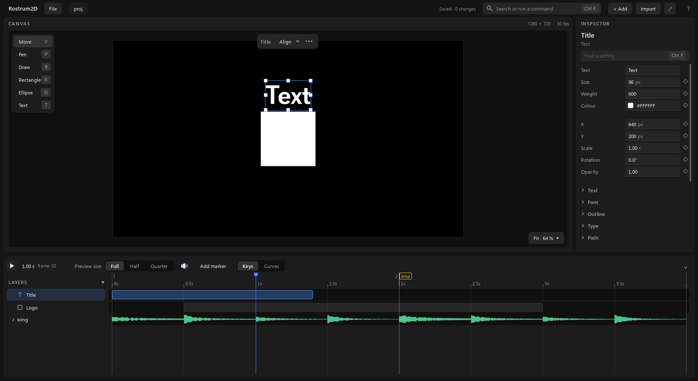
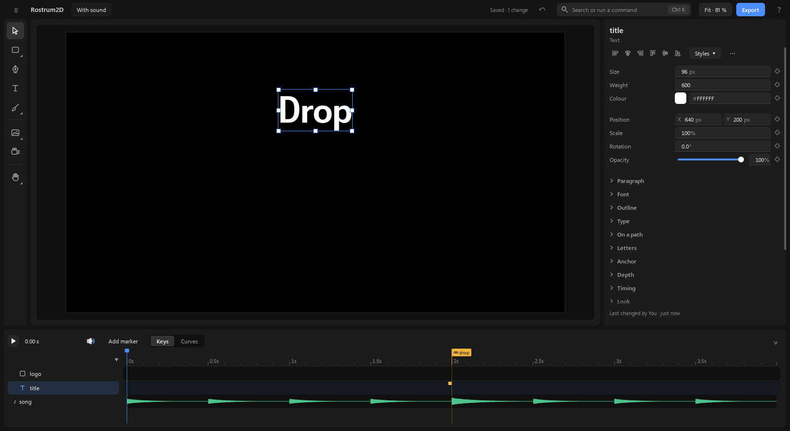

# Timing to music

When your project has music, voice or sound made in RostrumSound, Rostrum2D plays it with the picture, shows it as a row in the timeline, and lets you put things on its beats and on its markers. The sound itself is always made in RostrumSound and played by RostrumSound's engine: 2D does not mix or change it, so what you hear here is the same mix you will export from Sound.

## 1. Hearing the project's sound

1. Open a project that has a RostrumSound song in it. Rostrum2D finds it by itself.
2. Press **Space** (or the play button at the left of the timeline's header). The sound plays with the picture.
3. Drag the playhead in the ruler. You hear a short burst of the sound wherever you let it rest, so you can find a beat or a word by ear.
4. When the sound changes in RostrumSound (you or an agent edits the song, or a marker moves), 2D notices within a second and plays the new mix. While the new mix is being made, the Sound row says "Sound is rendering the mix…".

## 2. The Sound row

- The **Sound row** is the last row of the timeline, under every layer. Its name is the song's name, with a ♪ before it. On the right is the waveform: tall where the sound is loud, flat where it is quiet.
- It is there only when the project has sound.
- When the timeline is folded to its small height (the button at the right end of the ruler), the Sound row stays, under the selected layer.
- A voice line whose voice is not made yet in RostrumSound shows faded, with "not made yet" after its words. It is silent until RostrumSound makes it (its **Make voice**); the scene opens and plays as usual. An export that includes the sound stops and says which line is missing.
- If something is wrong, the row says so in red words instead of a waveform. For example, RostrumSound is not installed, the song can't be read, or your computer has no sound output. The same words show at the top of the window. The picture still plays.

## 3. Muting the sound

- Click the **speaker button** at the right end of the Sound row's name. It shows as pressed, with a cross in place of the sound waves, and the waveform fades. Click it again to hear the sound.
- Muting is only for this window. It does not change the song, and an export from RostrumSound still has all of its sound.

## 4. Picking which sound plays

1. Click an empty part of the canvas (outside every layer). The settings panel shows the scene's settings.
2. Click **+ Sound** under the scene's settings. The **Soundtrack** setting appears, showing **Main mix:** and the name of the project's main song.
3. Click **Soundtrack** to open its list. The first choice is **Main mix: <song>** (the project's main RostrumSound song, the one that plays unless you pick another); under it comes every RostrumSound song of the project, each by its name. Click one to play that song with this scene.

**+ Sound** and the Soundtrack setting are there only when the project has at least one RostrumSound song.

## 5. Showing the beats

1. Click the song's name on the Sound row (or right-click the row). Its menu opens.
2. Click **Show beats**. A faint line appears on every beat, and a stronger line with the bar's number on every bar.
3. To hide them, open the menu again and click **Hide beats**.

**Show beats** is in the menu only when the song has a tempo. When you zoom out far, the beat lines leave and only the bar lines stay.

## 6. Snapping to beats and markers

When you drag a layer's bar, its ends or a key in the timeline, it snaps to things nearby:

- markers first (the flags on the ruler), then the playhead, then the ends of other bars and other keys, then the beats of the music;
- a pink line down the timeline shows what it caught;
- hold **Ctrl** while you drag to turn snapping off, so it moves by whole frames.

A layer has a bar once it has keys (see [the-screen.md](the-screen.md)).

## 7. Tying a bar to a marker from the music

Markers made in RostrumSound (for example "drop") are shared with the whole project and show as flags on the ruler.

1. Drag the start or the end of a layer's bar towards the marker's line (every layer has a bar; the pointer turns into a two-way arrow over an end). A small label by the pointer names what it would snap to.
2. Let go when it snaps to the marker. A small yellow mark appears on that end: the end is now **tied** to the marker. The **Timing** group of the settings panel says so too: **Ends at marker** (or **Timed from marker**, for the start) shows the marker's name.
3. When the marker moves (someone changes the song in RostrumSound, or you drag the flag), the tied end moves with it. You don't have to do anything.

You can tie a whole bar the same way: drag its middle so that its start lands on the marker.

The same can be done without dragging: pick the layer, open **Timing** in the settings panel (click **+ Timing** if it is folded away) and pick the marker in **Timed from marker** (its start) or **Ends at marker** (its end).

## 8. Jumping from beat to beat

- **Shift+.** moves the playhead to the next beat; **Shift+,** to the one before.
- **.** and **,** (without Shift) still jump to the next or previous key, marker or drawing.

These keys work when the song has a tempo.

## 9. Changing the sound itself

Right-click the **Sound row** and choose **Open in RostrumSound**. RostrumSound opens on this project's song. Change the music, voice or markers there; 2D picks up the new sound by itself (see step 1.4).

Next: [the-screen.md](the-screen.md), [exporting.md](exporting.md).
